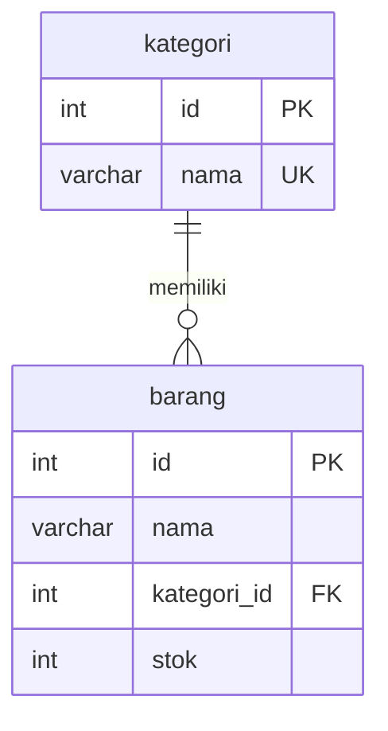

# Portal Manajemen & Informasi Tim

Panduan lengkap menyambungkan **Frontend (React + Vite)** dan **Backend (Express)** ke **database MySQL Laragon**, plus lampiran seluruh source code inti.

> Dokumen ini adalah panduan setup. `README.md` lama (template Vite + catatan singkat) tetap dipertahankan.

---

## Daftar Isi

1. [Ringkasan](#1-ringkasan)
2. [Arsitektur](#2-arsitektur)
3. [Prasyarat](#3-prasyarat)
4. [Struktur Folder](#4-struktur-folder)
5. [Langkah 1 — Nyalakan MySQL Laragon](#5-langkah-1--nyalakan-mysql-laragon)
6. [Langkah 2 — Hubungkan Backend ke Database](#6-langkah-2--hubungkan-backend-ke-database)
7. [Langkah 3 — Hubungkan Frontend ke Backend](#7-langkah-3--hubungkan-frontend-ke-backend)
8. [Verifikasi End-to-End](#8-verifikasi-end-to-end)
9. [Daftar Endpoint API](#9-daftar-endpoint-api)
10. [Skema Database](#10-skema-database)
11. [Script NPM](#11-script-npm)
12. [Troubleshooting](#12-troubleshooting)
13. [Lampiran Source Code Lengkap](#13-lampiran-source-code-lengkap)

---

## 1. Ringkasan

Aplikasi pelatihan fullstack BNSP dengan tiga tab utama:

| Tab | Fungsi |
| --- | --- |
| 👥 Anggota Tim | CRUD anggota tim (tambah, cari, edit, hapus, ubah status, beri bintang) |
| 📦 Data Barang | CRUD barang + kategori (relasi satu kategori ke banyak barang) |
| 📰 Berita Terkini | Menampilkan berita dari Berita Indo API (CNN Indonesia) |

| Lapisan | Teknologi | Lokasi |
| --- | --- | --- |
| Frontend | React 19, Vite 8, Tailwind CSS v4, Zod 4 | `src/` |
| Backend | Node.js, Express 5, mysql2, Zod 4 | `server/src/` |
| Database | MySQL 8.4 (Laragon), database `pelatihan_bnsp` | dibuat otomatis oleh `ensureSchema()` |
| Test | `node --test` bawaan Node | `src/**/*.test.js`, `server/test/` |

Frontend **tidak** terhubung langsung ke MySQL. Frontend memanggil REST API backend, lalu backend yang berbicara ke database lewat connection pool `mysql2`.

---

## 2. Arsitektur

```
Browser (React :5173)
   │  fetch('/api/members')
   ▼
Vite dev server (:5173) ──proxy /api──► Express API (:3000)
                                            │ mysql2 pool
                                            ▼
                                   MySQL Laragon (:3306)
                                   database pelatihan_bnsp
```

- **Development:** Vite mem-proxy `/api` ke `http://localhost:3000`, sehingga tidak ada masalah CORS dan frontend cukup memanggil path relatif `/api/...`.
- **Produksi:** proxy Vite tidak aktif. Perlu reverse proxy (Nginx/Apache) yang meneruskan `/api` ke backend, atau ubah base URL di client API.
- **CORS:** backend tetap memasang middleware CORS untuk origin frontend (`CORS_ORIGIN`), berguna saat frontend dan backend dijalankan di origin berbeda.

---

## 3. Prasyarat

| Kebutuhan | Versi / Catatan |
| --- | --- |
| Node.js | 20 atau lebih baru (di mesin pengembangan: v24.17.0) |
| npm | 10+ (di mesin pengembangan: 11.13.0) |
| Laragon | Dengan MySQL 8.4 (contoh path: `C:\laragon\bin\mysql\mysql-8.4.3-winx64`) |
| Port | `3306` (MySQL), `3000` (API), `5173` (Vite) |
| Kredensial default Laragon | user `root`, password kosong, host `127.0.0.1` |

---

## 4. Struktur Folder

```
pelatihan-bnsp/
├── index.html                  # Entry HTML Vite
├── package.json                # Dependency & script frontend + script bantu backend
├── vite.config.js              # Plugin React + Tailwind, proxy /api → :3000
├── eslint.config.js            # Konfigurasi ESLint (browser + Node)
├── README.md                   # README lama (template Vite)
├── README-SETUP.md             # Dokumen ini
├── src/                        # FRONTEND
│   ├── main.jsx                # Bootstrap React
│   ├── App.jsx                 # Shell aplikasi + tab navigation
│   ├── App.css                 # Styling lama (header, tab berita) — tidak dilampirkan
│   ├── index.css               # Entry Tailwind v4 tanpa preflight
│   ├── api/
│   │   ├── members.js          # Client REST anggota tim
│   │   └── barang.js           # Client REST barang & kategori
│   └── component/
│       ├── TeamDirectory.jsx   # State & logika CRUD anggota
│       ├── AddMemberForm.jsx   # Form tambah/edit anggota (Zod)
│       ├── TeamCard.jsx        # Kartu anggota
│       ├── BarangDirectory.jsx # State & logika CRUD barang
│       ├── AddBarangForm.jsx   # Form tambah/edit barang
│       ├── barangForm.js       # Validasi form barang (fungsi murni)
│       ├── NewsFeed.jsx        # Fetch berita eksternal
│       ├── NewsCard.jsx        # Kartu berita
│       ├── newsMapper.js       # Normalisasi data berita
│       ├── barangForm.test.js  # Test validasi barang
│       ├── newsMapper.test.js  # Test mapper berita
│       ├── Counter.jsx         # Legacy, tidak dipakai App
│       ├── GreetingForm.jsx    # Legacy, tidak dipakai App
│       ├── ProfileCard.jsx     # Legacy, tidak dipakai App
│       └── SkillList.jsx       # Legacy, tidak dipakai App
└── server/                     # BACKEND
    ├── package.json            # Dependency & script backend
    ├── .env.example            # Template konfigurasi (di-commit)
    ├── .env                    # Konfigurasi lokal (TIDAK di-commit)
    ├── sql/
    │   └── praktik.sql         # Latihan SQL (SELECT/WHERE/JOIN/FK/CHECK)
    ├── src/
    │   ├── index.js            # Bootstrap server + graceful shutdown
    │   ├── db.js               # Pool MySQL + ensureSchema()
    │   ├── schema.js           # Skema validasi Zod
    │   ├── app.js              # Definisi seluruh route REST API
    │   └── seed.js             # Data awal idempoten
    └── test/
        ├── members.test.js     # Test CRUD anggota
        └── barang.test.js      # Test CRUD barang + CORS
```

---

## 5. Langkah 1 — Nyalakan MySQL Laragon

1. Buka **Laragon**.
2. Klik **Start All** (minimal **MySQL** harus berjalan; Apache tidak dipakai).
3. Pastikan port 3306 terbuka:

   ```powershell
   Test-NetConnection 127.0.0.1 -Port 3306
   ```

   Hasil yang benar: `TcpTestSucceeded : True`.

4. Opsional: buka **HeidiSQL** dari Laragon untuk memastikan koneksi `root` (password kosong) berhasil.

---

## 6. Langkah 2 — Hubungkan Backend ke Database

### 6.1 Buat file konfigurasi

```powershell
copy server\.env.example server\.env
```

Isi `server/.env` (default sudah cocok untuk Laragon):

```env
PORT=3000
DB_HOST=127.0.0.1
DB_PORT=3306
DB_USER=root
DB_PASSWORD=
DB_NAME=pelatihan_bnsp

# Origin frontend yang diizinkan (pisahkan dengan koma bila lebih dari satu)
CORS_ORIGIN=http://localhost:5173,http://127.0.0.1:5173
```

> Jika MySQL Laragon memakai password, isi `DB_PASSWORD`.
> Jika port MySQL berbeda (misalnya 3307), ubah `DB_PORT`.
> `server/.env` sudah masuk `.gitignore`, jadi kredensial tidak ikut ter-commit.

### 6.2 Install dependency backend

```powershell
npm --prefix server install
```

### 6.3 Buat database, tabel, dan data awal

```powershell
npm run seed
```

Yang terjadi:

1. `ensureSchema()` membuat database `pelatihan_bnsp` bila belum ada.
2. Membuat tabel `members`, `kategori`, dan `barang` beserta foreign key dan CHECK constraint.
3. Mengisi 3 anggota, 5 kategori, dan 7 barang contoh.
4. Aman dijalankan berulang (idempoten): data yang sudah ada/diedit tidak ditimpa.

### 6.4 Jalankan backend

```powershell
npm run server
```

Output yang benar:

```
API Anggota Tim berjalan di http://localhost:3000
```

Script ini otomatis memuat `server/.env` lewat flag `--env-file-if-exists=.env`.

### 6.5 Verifikasi backend ↔ database

```powershell
curl http://localhost:3000/api/members
```

Kalau keluar JSON berisi Budi Santoso, Siti Rahma, dan Ahmad Fauzi, berarti backend sudah tersambung ke MySQL.

Cek langsung dari MySQL:

```powershell
& "C:\laragon\bin\mysql\mysql-8.4.3-winx64\bin\mysql.exe" -u root -h 127.0.0.1 -P 3306 -e "USE pelatihan_bnsp; SHOW TABLES; SELECT COUNT(*) AS members FROM members;"
```

### 6.6 Test backend (opsional)

```powershell
npm run test:server
```

Test memakai database terpisah `pelatihan_bnsp_test`, jadi data latihan tidak tersentuh.

---

## 7. Langkah 3 — Hubungkan Frontend ke Backend

### 7.1 Pastikan proxy Vite benar

`vite.config.js` harus berisi:

```js
server: {
  proxy: {
    '/api': 'http://localhost:3000',
  },
},
```

Inilah yang membuat `fetch('/api/...')` di frontend diteruskan ke Express dan menghindari CORS saat development.

### 7.2 Jalankan frontend

Di terminal kedua:

```powershell
npm run dev
```

Buka `http://localhost:5173`.

### 7.3 Verifikasi frontend ↔ backend

- Tab **👥 Anggota Tim** menampilkan data dari database (bukan data hardcode).
- Tambah anggota → kartu langsung muncul.
- Refresh browser → data tetap ada.
- Buka HeidiSQL → baris baru ikut masuk ke tabel `members`.

---

## 8. Verifikasi End-to-End

| Cek | Cara | Hasil benar |
| --- | --- | --- |
| MySQL hidup | `Test-NetConnection 127.0.0.1 -Port 3306` | `True` |
| DB & tabel ada | HeidiSQL / `SHOW TABLES` | `members`, `kategori`, `barang` |
| Backend hidup | Buka `http://localhost:3000/api/members` | JSON array |
| Frontend hidup | Buka `http://localhost:5173` | UI tampil |
| Rantai lengkap | Tambah anggota di UI → refresh HeidiSQL | Baris baru muncul |
| Test backend | `npm run test:server` | Semua test lulus |
| Test frontend | `npm run test` | Semua test lulus |
| Lint & build | `npm run lint` dan `npm run build` | Sukses |

Urutan menjalankan aplikasi:

```powershell
# Terminal 0: Laragon → Start All (MySQL)

# Terminal 1
npm run server

# Terminal 2
npm run dev
```

---

## 9. Daftar Endpoint API

Base URL development: `http://localhost:3000` (dari frontend cukup `/api/...`).

### Anggota Tim

| Method | Path | Body | Respons sukses | Keterangan |
| --- | --- | --- | --- | --- |
| GET | `/api/members` | — | `200` array | Urut `created_at ASC` |
| POST | `/api/members` | `{ namaLengkap, email, posisi }` | `201` objek | Server menentukan `id` (UUID), `status: 'Online'`, `rating: 0`, `avatar` |
| PUT | `/api/members/:id` | sebagian field | `200` objek | Update parsial (form edit, status, atau rating) |
| DELETE | `/api/members/:id` | — | `204` | `404` bila tidak ada |

### Barang & Kategori

| Method | Path | Body | Respons sukses | Keterangan |
| --- | --- | --- | --- | --- |
| GET | `/api/kategori` | — | `200` array | Untuk dropdown form barang |
| GET | `/api/barang` | — | `200` array | JOIN kategori → ada field `kategori` |
| GET | `/api/barang/:id` | — | `200` objek | `400` ID bukan angka, `404` tidak ada |
| POST | `/api/barang` | `{ nama, kategoriId, stok }` | `201` objek | Kategori harus ada, stok integer ≥ 0 |
| PUT / PATCH | `/api/barang/:id` | sebagian field | `200` objek | Handler sama, body boleh sebagian |
| DELETE | `/api/barang/:id` | — | `204` | `404` bila tidak ada |

### Format Error

Validasi gagal (`400`):

```json
{
  "message": "Nama barang wajib diisi",
  "errors": {
    "nama": "Nama barang wajib diisi",
    "stok": "Stok tidak boleh negatif"
  }
}
```

Error lain:

| Status | Body |
| --- | --- |
| `400` | `{ "message": "Body JSON tidak valid" }` |
| `404` | `{ "message": "Endpoint tidak ditemukan" }` |
| `500` | `{ "message": "Terjadi kesalahan pada server" }` |

Kontrak data memakai **camelCase** (`namaLengkap`, `kategoriId`), walaupun kolom database **snake_case** (`nama_lengkap`, `kategori_id`). Konversi dilakukan oleh `mapRow()` dan `mapBarangRow()` di `server/src/app.js`.

---

## 10. Skema Database

Database: `pelatihan_bnsp` (utf8mb4). Dibuat otomatis oleh `ensureSchema()` di `server/src/db.js`.

### Tabel `members`

| Kolom | Tipe | Keterangan |
| --- | --- | --- |
| `id` | `CHAR(36)` PK | UUID dari server (seed memakai `'1'`, `'2'`, `'3'`) |
| `nama_lengkap` | `VARCHAR(120)` | Wajib |
| `email` | `VARCHAR(160)` | Wajib |
| `posisi` | `VARCHAR(80)` | Wajib |
| `status` | `ENUM('Online','Offline')` | Default `Online` |
| `rating` | `INT` | Default `0` |
| `avatar` | `VARCHAR(255)` | URL avatar |
| `created_at` | `TIMESTAMP` | Default `CURRENT_TIMESTAMP` |
| `updated_at` | `TIMESTAMP` | Auto update |

### Tabel `kategori`

| Kolom | Tipe | Keterangan |
| --- | --- | --- |
| `id` | `INT UNSIGNED` PK AI | |
| `nama` | `VARCHAR(80)` | `UNIQUE KEY uq_kategori_nama` |
| `created_at` | `TIMESTAMP` | Default `CURRENT_TIMESTAMP` |

### Tabel `barang`

| Kolom | Tipe | Keterangan |
| --- | --- | --- |
| `id` | `INT UNSIGNED` PK AI | |
| `nama` | `VARCHAR(120)` | Wajib |
| `kategori_id` | `INT UNSIGNED` | FK ke `kategori.id` |
| `stok` | `INT` | Default `0`, `CHECK (stok >= 0)` |
| `created_at` | `TIMESTAMP` | Default `CURRENT_TIMESTAMP` |
| `updated_at` | `TIMESTAMP` | Auto update |

Foreign key: `fk_barang_kategori` → `ON UPDATE CASCADE`, `ON DELETE RESTRICT`.
Check constraint: `chk_barang_stok` → `stok >= 0`.

### ERD



### Data seed

| Anggota | Posisi | Status | Rating |
| --- | --- | --- | --- |
| Budi Santoso | Frontend Dev | Online | 2 |
| Siti Rahma | UI/UX Designer | Offline | 5 |
| Ahmad Fauzi | Backend Engineer | Online | 1 |

Kategori: Elektronik, ATK, Makanan, Minuman, Pakaian.
Barang: Laptop Belajar, Mouse Wireless, Pulpen Gel, Buku Tulis, Kopi Sachet, Air Mineral, Kaos Pelatihan.

Latihan query SQL ada di `server/sql/praktik.sql` (SELECT, WHERE, ORDER BY, UPDATE, DELETE, JOIN, uji FK/CHECK). Query yang mengubah data dibungkus `START TRANSACTION … ROLLBACK` agar data asli aman.

---

## 11. Script NPM

Dijalankan dari root project:

| Script | Perintah | Fungsi |
| --- | --- | --- |
| `npm run dev` | `vite` | Frontend development di `:5173` |
| `npm run build` | `vite build` | Build produksi ke `dist/` |
| `npm run preview` | `vite preview` | Preview hasil build |
| `npm run lint` | `eslint .` | Cek kualitas kode |
| `npm run test` | `node --test "src/**/*.test.js"` | Test frontend (fungsi murni) |
| `npm run server` | `npm --prefix server start` | Jalankan API di `:3000` |
| `npm run server:dev` | `npm --prefix server run dev` | API dengan `node --watch` |
| `npm run seed` | `npm --prefix server run seed` | Isi data awal (idempoten) |
| `npm run test:server` | `npm --prefix server test` | Test backend (`node --test`) |

---

## 12. Troubleshooting

### Lapisan Backend ↔ MySQL

| Gejala | Penyebab | Solusi |
| --- | --- | --- |
| `ECONNREFUSED 127.0.0.1:3306` | MySQL belum jalan | Klik **Start All** di Laragon |
| `ER_ACCESS_DENIED_ERROR` | User/password salah | Sesuaikan `DB_USER` / `DB_PASSWORD` di `server/.env` |
| `ER_BAD_DB_ERROR` | Database belum ada | Jalankan `npm run seed` |
| `EADDRINUSE :3000` | Port 3000 dipakai proses lain | Ubah `PORT` di `.env` **dan** target proxy `vite.config.js` |
| Perubahan `.env` tidak terbaca | Server masih proses lama | Hentikan lalu jalankan ulang `npm run server` |
| Tabel tidak muncul di HeidiSQL | Koneksi belum refresh | Refresh koneksi, pastikan database `pelatihan_bnsp` |

### Lapisan Frontend ↔ Backend

| Gejala | Penyebab | Solusi |
| --- | --- | --- |
| UI kosong + "Pastikan server API berjalan" | Backend belum jalan / port beda | Jalankan `npm run server`, cek `:3000` |
| `404` pada `/api/...` | Proxy salah target | Perbaiki `server.proxy` di `vite.config.js` |
| CORS error | Origin tidak diizinkan | Tambahkan ke `CORS_ORIGIN`, restart backend |
| Data tidak berubah setelah edit | Request gagal (validasi) | Cek pesan error di UI; lihat response API |
| Berita tidak muncul | API eksternal butuh internet | Cek koneksi; tombol **Segarkan Berita** |

### Catatan keamanan & konfigurasi

- `server/.env` **jangan di-commit**. Yang dibagikan cukup `server/.env.example`.
- Semua query memakai parameterized query (`?`), aman dari SQL injection.
- `PUT /api/members/:id` menerima body parsial; body kosong ditolak `400`.
- Di produksi, jangan mengandalkan proxy Vite. Gunakan reverse proxy atau base URL API eksplisit.

---

## 13. Lampiran Source Code Lengkap

Bagian ini berisi isi lengkap file inti, disalin langsung dari project.

**Tidak dilampirkan** (tetap wajib ada di project):

- `src/App.css` (±35 KB, styling header/tab/berita)
- `package-lock.json`, `server/package-lock.json`
- `dist/`, `node_modules/`
- `src/assets/*`, `public/*`
- Komponen legacy yang tidak dipakai `App.jsx`: `Counter.jsx`, `GreetingForm.jsx`, `ProfileCard.jsx`, `SkillList.jsx`
- `docs/superpowers/plans/*` (catatan historis perencanaan)

---

### `package.json`

```json
{
  "name": "aplikasi-react-pertama",
  "private": true,
  "version": "0.0.0",
  "type": "module",
  "scripts": {
    "dev": "vite",
    "build": "vite build",
    "lint": "eslint .",
    "test": "node --test \"src/**/*.test.js\"",
    "preview": "vite preview",
    "server": "npm --prefix server start",
    "server:dev": "npm --prefix server run dev",
    "seed": "npm --prefix server run seed",
    "test:server": "npm --prefix server test"
  },
  "dependencies": {
    "@tailwindcss/vite": "^4.3.5",
    "react": "^19.3.1",
    "react-dom": "^19.3.1",
    "tailwindcss": "^4.3.5",
    "zod": "^4.6.7"
  },
  "devDependencies": {
    "@eslint/js": "^10.0.1",
    "@types/react": "^19.3.0",
    "@types/react-dom": "^19.3.0",
    "@vitejs/plugin-react": "^6.1.2",
    "eslint": "^10.13.0",
    "eslint-plugin-react-hooks": "^7.1.1",
    "eslint-plugin-react-refresh": "^0.5.7",
    "globals": "^17.13.0",
    "vite": "^8.3.5"
  }
}
```

### `vite.config.js`

```js
import react from '@vitejs/plugin-react'
import tailwindcss from '@tailwindcss/vite'
import { defineConfig } from 'vite'

// https://vite.dev/config/
export default defineConfig({
  plugins: [react(), tailwindcss()],
  server: {
    // Frontend memanggil /api/... dan Vite meneruskannya ke server Express.
    // Dengan proxy ini tidak ada masalah CORS saat development.
    proxy: {
      '/api': 'http://localhost:3000',
    },
  },
})
```

### `index.html`

```html
<!doctype html>
<html lang="en">
  <head>
    <meta charset="UTF-8" />
    <link rel="icon" type="image/svg+xml" href="/favicon.svg" />
    <meta name="viewport" content="width=device-width, initial-scale=1.0" />
    <title>aplikasi-react-pertama</title>
  </head>
  <body>
    <div id="root"></div>
    <script type="module" src="/src/main.jsx"></script>
  </body>
</html>
```

### `eslint.config.js`

```js
import js from '@eslint/js'
import globals from 'globals'
import reactHooks from 'eslint-plugin-react-hooks'
import reactRefresh from 'eslint-plugin-react-refresh'
import { defineConfig, globalIgnores } from 'eslint/config'

export default defineConfig([
  globalIgnores(['dist']),
  {
    files: ['**/*.{js,jsx}'],
    extends: [
      js.configs.recommended,
      reactHooks.configs.flat.recommended,
      reactRefresh.configs.vite,
    ],
    languageOptions: {
      globals: globals.browser,
      parserOptions: { ecmaFeatures: { jsx: true } },
    },
  },
  {
    // Backend Node.js: global Node, bukan browser; aturan React tidak relevan
    files: ['server/**/*.js'],
    languageOptions: {
      globals: globals.node,
    },
    rules: {
      'react-refresh/only-export-components': 'off',
    },
  },
])
```

### `.gitignore`

```text
# Logs
logs
*.log
npm-debug.log*
yarn-debug.log*
yarn-error.log*
pnpm-debug.log*
lerna-debug.log*

node_modules
dist
dist-ssr
*.local

# Superpowers scratch (ledger, briefs, review packages)
.superpowers/

# Kredensial lokal backend
server/.env

# Editor directories and files
.vscode/*
!.vscode/extensions.json
.idea
.DS_Store
*.suo
*.ntvs*
*.njsproj
*.sln
*.sw?
```

### `server/package.json`

```json
{
  "name": "server-anggota-tim",
  "private": true,
  "version": "1.0.0",
  "type": "module",
  "description": "REST API + MySQL untuk dashboard Anggota Tim",
  "scripts": {
    "start": "node --env-file-if-exists=.env src/index.js",
    "dev": "node --watch --env-file-if-exists=.env src/index.js",
    "seed": "node --env-file-if-exists=.env src/seed.js",
    "test": "node --test"
  },
  "dependencies": {
    "cors": "^2.8.6",
    "express": "^5.3.0",
    "mysql2": "^3.24.6",
    "zod": "^4.6.7"
  }
}
```

### `server/.env.example`

```env
PORT=3000
DB_HOST=127.0.0.1
DB_PORT=3306
DB_USER=root
DB_PASSWORD=
DB_NAME=pelatihan_bnsp

# Origin frontend yang diizinkan (pisahkan dengan koma bila lebih dari satu)
CORS_ORIGIN=http://localhost:5173,http://127.0.0.1:5173
```

### `server/src/index.js`

```js
import { createApp } from './app.js';
import { ensureSchema, pool } from './db.js';

const port = Number(process.env.PORT || 3000);

await ensureSchema();

const server = createApp().listen(port, () => {
  console.log(`API Anggota Tim berjalan di http://localhost:${port}`);
});

async function shutdown(signal) {
  console.log(`\n${signal} diterima — menutup server...`);
  server.close(async () => {
    await pool.end();
    process.exit(0);
  });
}

process.on('SIGINT', () => shutdown('SIGINT'));
process.on('SIGTERM', () => shutdown('SIGTERM'));
```

### `server/src/db.js`

```js
import mysql from 'mysql2/promise';

const connectionConfig = {
  host: process.env.DB_HOST || '127.0.0.1',
  port: Number(process.env.DB_PORT || 3306),
  user: process.env.DB_USER || 'root',
  password: process.env.DB_PASSWORD || '',
};

export const dbName = process.env.DB_NAME || 'pelatihan_bnsp';

// Pool dipakai seluruh route. Koneksi fisik baru dibuat saat query pertama.
export const pool = mysql.createPool({
  ...connectionConfig,
  database: dbName,
  waitForConnections: true,
  connectionLimit: 10,
});

// Membuat database & tabel bila belum ada — aman dijalankan berulang kali.
export async function ensureSchema() {
  const admin = await mysql.createConnection(connectionConfig);
  try {
    await admin.query(
      `CREATE DATABASE IF NOT EXISTS \`${dbName}\` CHARACTER SET utf8mb4 COLLATE utf8mb4_unicode_ci`
    );
  } finally {
    await admin.end();
  }

  await pool.query(`
    CREATE TABLE IF NOT EXISTS members (
      id CHAR(36) NOT NULL PRIMARY KEY,
      nama_lengkap VARCHAR(120) NOT NULL,
      email VARCHAR(160) NOT NULL,
      posisi VARCHAR(80) NOT NULL,
      status ENUM('Online', 'Offline') NOT NULL DEFAULT 'Online',
      rating INT NOT NULL DEFAULT 0,
      avatar VARCHAR(255) NOT NULL,
      created_at TIMESTAMP NOT NULL DEFAULT CURRENT_TIMESTAMP,
      updated_at TIMESTAMP NOT NULL DEFAULT CURRENT_TIMESTAMP ON UPDATE CURRENT_TIMESTAMP
    ) ENGINE=InnoDB DEFAULT CHARSET=utf8mb4 COLLATE=utf8mb4_unicode_ci
  `);

  // Relasi satu kategori ke banyak barang (foreign key).
  await pool.query(`
    CREATE TABLE IF NOT EXISTS kategori (
      id INT UNSIGNED NOT NULL AUTO_INCREMENT PRIMARY KEY,
      nama VARCHAR(80) NOT NULL,
      created_at TIMESTAMP NOT NULL DEFAULT CURRENT_TIMESTAMP,
      UNIQUE KEY uq_kategori_nama (nama)
    ) ENGINE=InnoDB DEFAULT CHARSET=utf8mb4 COLLATE=utf8mb4_unicode_ci
  `);

  await pool.query(`
    CREATE TABLE IF NOT EXISTS barang (
      id INT UNSIGNED NOT NULL AUTO_INCREMENT PRIMARY KEY,
      nama VARCHAR(120) NOT NULL,
      kategori_id INT UNSIGNED NOT NULL,
      stok INT NOT NULL DEFAULT 0,
      created_at TIMESTAMP NOT NULL DEFAULT CURRENT_TIMESTAMP,
      updated_at TIMESTAMP NOT NULL DEFAULT CURRENT_TIMESTAMP ON UPDATE CURRENT_TIMESTAMP,
      CONSTRAINT fk_barang_kategori FOREIGN KEY (kategori_id)
        REFERENCES kategori (id) ON UPDATE CASCADE ON DELETE RESTRICT,
      CONSTRAINT chk_barang_stok CHECK (stok >= 0)
    ) ENGINE=InnoDB DEFAULT CHARSET=utf8mb4 COLLATE=utf8mb4_unicode_ci
  `);
}
```

### `server/src/schema.js`

```js
import { z } from 'zod';

// Pesan validasi sengaja sama dengan pesan di form frontend (Zod) agar konsisten.
export const createMemberSchema = z.object({
  namaLengkap: z
    .string()
    .trim()
    .min(3, 'Nama lengkap minimal 3 karakter')
    .max(120, 'Nama lengkap maksimal 120 karakter'),
  email: z.email('Format email tidak valid').max(160, 'Email maksimal 160 karakter'),
  posisi: z
    .string()
    .trim()
    .min(1, 'Wajib memilih salah satu peran tim')
    .max(80, 'Posisi maksimal 80 karakter'),
});

// PUT menerima sebagian field (form edit mengirim 3 field; tombol status/bintang 1 field).
export const updateMemberSchema = z
  .object({
    namaLengkap: z
      .string()
      .trim()
      .min(3, 'Nama lengkap minimal 3 karakter')
      .max(120, 'Nama lengkap maksimal 120 karakter'),
    email: z.email('Format email tidak valid').max(160, 'Email maksimal 160 karakter'),
    posisi: z
      .string()
      .trim()
      .min(1, 'Wajib memilih salah satu peran tim')
      .max(80, 'Posisi maksimal 80 karakter'),
    status: z.enum(['Online', 'Offline'], 'Status harus Online atau Offline'),
    rating: z
      .number('Rating harus berupa angka')
      .int('Rating harus bilangan bulat')
      .min(0, 'Rating minimal 0'),
  })
  .partial()
  .refine((data) => Object.keys(data).length > 0, {
    message: 'Tidak ada data yang diubah',
  });

// Input dari JSON/form bisa berupa string ("8") — ubah ke angka,
// tetapi biarkan kosong/null/undefined agar validasi "wajib diisi" tetap jalan.
function toNumber(value) {
  if (value === '' || value === null || value === undefined) return undefined;
  return Number(value);
}

const kategoriIdSchema = z.preprocess(
  toNumber,
  z
    .number('Kategori wajib dipilih')
    .int('Kategori tidak valid')
    .positive('Kategori tidak valid')
);

const stokSchema = z.preprocess(
  toNumber,
  z
    .number('Stok harus berupa angka')
    .int('Stok harus bilangan bulat')
    .min(0, 'Stok tidak boleh negatif')
);

export const createBarangSchema = z.object({
  nama: z
    .string()
    .trim()
    .min(1, 'Nama barang wajib diisi')
    .max(120, 'Nama barang maksimal 120 karakter'),
  kategoriId: kategoriIdSchema,
  stok: stokSchema,
});

// PUT/PATCH menerima sebagian field.
export const updateBarangSchema = z
  .object({
    nama: z
      .string()
      .trim()
      .min(1, 'Nama barang wajib diisi')
      .max(120, 'Nama barang maksimal 120 karakter'),
    kategoriId: kategoriIdSchema,
    stok: stokSchema,
  })
  .partial()
  .refine((data) => Object.keys(data).length > 0, {
    message: 'Tidak ada data yang diubah',
  });
```

### `server/src/app.js`

```js
import cors from 'cors';
import express from 'express';
import { randomUUID } from 'node:crypto';
import { pool } from './db.js';
import {
  createBarangSchema,
  createMemberSchema,
  updateBarangSchema,
  updateMemberSchema,
} from './schema.js';

const COLUMNS = 'id, nama_lengkap, email, posisi, status, rating, avatar';

const BARANG_COLUMNS = 'b.id, b.nama, b.kategori_id, k.nama AS kategori, b.stok';

// Pemetaan kolom snake_case (MySQL) → field camelCase (kontrak API/frontend)
function mapRow(row) {
  return {
    id: row.id,
    namaLengkap: row.nama_lengkap,
    email: row.email,
    posisi: row.posisi,
    status: row.status,
    rating: row.rating,
    avatar: row.avatar,
  };
}

function mapBarangRow(row) {
  return {
    id: row.id,
    nama: row.nama,
    kategoriId: row.kategori_id,
    kategori: row.kategori,
    stok: row.stok,
  };
}

// ID dari URL harus bilangan bulat positif; selain itu dianggap tidak valid.
function parseId(value) {
  if (!/^\d+$/.test(value)) return null;
  const id = Number(value);
  return Number.isSafeInteger(id) && id > 0 ? id : null;
}

async function findBarangById(id) {
  const [rows] = await pool.query(
    `SELECT ${BARANG_COLUMNS} FROM barang b
     JOIN kategori k ON k.id = b.kategori_id
     WHERE b.id = ?`,
    [id]
  );
  return rows.length > 0 ? mapBarangRow(rows[0]) : null;
}

async function kategoriExists(id) {
  const [rows] = await pool.query('SELECT id FROM kategori WHERE id = ?', [id]);
  return rows.length > 0;
}

// Express 5 meneruskan error async otomatis; helper ini menjaga kompatibilitas Express 4.
const asyncHandler = (fn) => (req, res, next) =>
  Promise.resolve(fn(req, res, next)).catch(next);

function validate(schema, body) {
  const result = schema.safeParse(body);
  if (result.success) return { data: result.data };

  const errors = {};
  for (const issue of result.error.issues) {
    const field = issue.path[0];
    if (field !== undefined && errors[field] === undefined) {
      errors[field] = issue.message;
    }
  }

  return { errors, message: result.error.issues[0].message };
}

export function createApp() {
  const app = express();

  // Bagian 4: izinkan frontend dari origin (port) berbeda.
  // Default: Vite dev di localhost/127.0.0.1 port 5173.
  // Ubah lewat CORS_ORIGIN di .env (pisahkan dengan koma bila lebih dari satu).
  const allowedOrigins = (
    process.env.CORS_ORIGIN ?? 'http://localhost:5173,http://127.0.0.1:5173'
  )
    .split(',')
    .map((origin) => origin.trim())
    .filter(Boolean);

  app.use(cors({ origin: allowedOrigins }));
  app.use(express.json());

  // Daftar anggota (urut dari yang paling lama agar seed tampil sesuai spesifikasi)
  app.get(
    '/api/members',
    asyncHandler(async (req, res) => {
      const [rows] = await pool.query(
        `SELECT ${COLUMNS} FROM members ORDER BY created_at ASC, id ASC`
      );
      res.json(rows.map(mapRow));
    })
  );

  // Tambah anggota: id, status, rating, dan avatar ditentukan server
  app.post(
    '/api/members',
    asyncHandler(async (req, res) => {
      const parsed = validate(createMemberSchema, req.body);
      if (parsed.errors) {
        return res.status(400).json({
          message: parsed.message,
          errors: parsed.errors,
        });
      }

      const id = randomUUID();
      const member = {
        id,
        ...parsed.data,
        status: 'Online',
        rating: 0,
        avatar: `https://i.pravatar.cc/150?u=${id}`,
      };

      await pool.query(
        `INSERT INTO members (id, nama_lengkap, email, posisi, status, rating, avatar)
         VALUES (?, ?, ?, ?, ?, ?, ?)`,
        [
          member.id,
          member.namaLengkap,
          member.email,
          member.posisi,
          member.status,
          member.rating,
          member.avatar,
        ]
      );

      res.status(201).json(member);
    })
  );

  // Ubah anggota (body boleh sebagian)
  app.put(
    '/api/members/:id',
    asyncHandler(async (req, res) => {
      const parsed = validate(updateMemberSchema, req.body);
      if (parsed.errors) {
        return res.status(400).json({
          message: parsed.message,
          errors: parsed.errors,
        });
      }

      const columnByField = {
        namaLengkap: 'nama_lengkap',
        email: 'email',
        posisi: 'posisi',
        status: 'status',
        rating: 'rating',
      };

      const assignments = [];
      const values = [];
      for (const [field, column] of Object.entries(columnByField)) {
        if (parsed.data[field] !== undefined) {
          assignments.push(`${column} = ?`);
          values.push(parsed.data[field]);
        }
      }

      await pool.query(`UPDATE members SET ${assignments.join(', ')} WHERE id = ?`, [
        ...values,
        req.params.id,
      ]);

      const [rows] = await pool.query(
        `SELECT ${COLUMNS} FROM members WHERE id = ?`,
        [req.params.id]
      );

      if (rows.length === 0) {
        return res.status(404).json({ message: 'Anggota tim tidak ditemukan' });
      }

      res.json(mapRow(rows[0]));
    })
  );

  // Hapus anggota
  app.delete(
    '/api/members/:id',
    asyncHandler(async (req, res) => {
      const [result] = await pool.query('DELETE FROM members WHERE id = ?', [
        req.params.id,
      ]);

      if (result.affectedRows === 0) {
        return res.status(404).json({ message: 'Anggota tim tidak ditemukan' });
      }

      res.status(204).end();
    })
  );

  // Daftar kategori (dipakai untuk dropdown form barang)
  app.get(
    '/api/kategori',
    asyncHandler(async (req, res) => {
      const [rows] = await pool.query(
        'SELECT id, nama FROM kategori ORDER BY nama ASC'
      );
      res.json(rows);
    })
  );

  // Daftar barang + nama kategori (query JOIN)
  app.get(
    '/api/barang',
    asyncHandler(async (req, res) => {
      const [rows] = await pool.query(
        `SELECT ${BARANG_COLUMNS} FROM barang b
         JOIN kategori k ON k.id = b.kategori_id
         ORDER BY b.id ASC`
      );
      res.json(rows.map(mapBarangRow));
    })
  );

  app.get(
    '/api/barang/:id',
    asyncHandler(async (req, res) => {
      const id = parseId(req.params.id);
      if (id === null) {
        return res.status(400).json({ message: 'ID barang harus berupa angka positif' });
      }

      const barang = await findBarangById(id);
      if (!barang) {
        return res.status(404).json({ message: 'Barang tidak ditemukan' });
      }

      res.json(barang);
    })
  );

  // Tambah barang: nama wajib, stok bilangan bulat >= 0, kategori harus ada.
  app.post(
    '/api/barang',
    asyncHandler(async (req, res) => {
      const parsed = validate(createBarangSchema, req.body);
      if (parsed.errors) {
        return res.status(400).json({
          message: parsed.message,
          errors: parsed.errors,
        });
      }

      if (!(await kategoriExists(parsed.data.kategoriId))) {
        return res.status(400).json({
          message: 'Kategori tidak ditemukan',
          errors: { kategoriId: 'Kategori tidak ditemukan' },
        });
      }

      const [result] = await pool.query(
        'INSERT INTO barang (nama, kategori_id, stok) VALUES (?, ?, ?)',
        [parsed.data.nama, parsed.data.kategoriId, parsed.data.stok]
      );

      res.status(201).json(await findBarangById(result.insertId));
    })
  );

  // PUT dan PATCH memakai handler yang sama (body boleh sebagian).
  const updateBarang = asyncHandler(async (req, res) => {
    const id = parseId(req.params.id);
    if (id === null) {
      return res.status(400).json({ message: 'ID barang harus berupa angka positif' });
    }

    const parsed = validate(updateBarangSchema, req.body);
    if (parsed.errors) {
      return res.status(400).json({
        message: parsed.message,
        errors: parsed.errors,
      });
    }

    const existing = await findBarangById(id);
    if (!existing) {
      return res.status(404).json({ message: 'Barang tidak ditemukan' });
    }

    if (parsed.data.kategoriId !== undefined && !(await kategoriExists(parsed.data.kategoriId))) {
      return res.status(400).json({
        message: 'Kategori tidak ditemukan',
        errors: { kategoriId: 'Kategori tidak ditemukan' },
      });
    }

    const columnByField = { nama: 'nama', kategoriId: 'kategori_id', stok: 'stok' };
    const assignments = [];
    const values = [];
    for (const [field, column] of Object.entries(columnByField)) {
      if (parsed.data[field] !== undefined) {
        assignments.push(`${column} = ?`);
        values.push(parsed.data[field]);
      }
    }

    await pool.query(`UPDATE barang SET ${assignments.join(', ')} WHERE id = ?`, [
      ...values,
      id,
    ]);

    res.json(await findBarangById(id));
  });

  app.put('/api/barang/:id', updateBarang);
  app.patch('/api/barang/:id', updateBarang);

  app.delete(
    '/api/barang/:id',
    asyncHandler(async (req, res) => {
      const id = parseId(req.params.id);
      if (id === null) {
        return res.status(400).json({ message: 'ID barang harus berupa angka positif' });
      }

      const [result] = await pool.query('DELETE FROM barang WHERE id = ?', [id]);

      if (result.affectedRows === 0) {
        return res.status(404).json({ message: 'Barang tidak ditemukan' });
      }

      res.status(204).end();
    })
  );

  app.use((req, res) => {
    res.status(404).json({ message: 'Endpoint tidak ditemukan' });
  });

  // eslint-disable-next-line no-unused-vars
  app.use((err, req, res, next) => {
    if (err.type === 'entity.parse.failed') {
      return res.status(400).json({ message: 'Body JSON tidak valid' });
    }
    console.error('[server] Kesalahan tak terduga:', err);
    res.status(500).json({ message: 'Terjadi kesalahan pada server' });
  });

  return app;
}
```

### `server/src/seed.js`

```js
import { ensureSchema, pool } from './db.js';

// Data awal sesuai spesifikasi pelatihan. Idempoten: data yang sudah ada
// (termasuk hasil edit user) tidak ditimpa.
const SEED_MEMBERS = [
  {
    id: '1',
    namaLengkap: 'Budi Santoso',
    email: 'budi.santoso@perusahaan.com',
    posisi: 'Frontend Dev',
    status: 'Online',
    rating: 2,
    avatar: 'https://i.pravatar.cc/150?u=1',
  },
  {
    id: '2',
    namaLengkap: 'Siti Rahma',
    email: 'siti.rahma@perusahaan.com',
    posisi: 'UI/UX Designer',
    status: 'Offline',
    rating: 5,
    avatar: 'https://i.pravatar.cc/150?u=2',
  },
  {
    id: '3',
    namaLengkap: 'Ahmad Fauzi',
    email: 'ahmad.fauzi@perusahaan.com',
    posisi: 'Backend Engineer',
    status: 'Online',
    rating: 1,
    avatar: 'https://i.pravatar.cc/150?u=3',
  },
];

// Bagian 1 praktik: data kategori dan minimal 5 barang awal.
const SEED_KATEGORI = ['Elektronik', 'ATK', 'Makanan', 'Minuman', 'Pakaian'];

const SEED_BARANG = [
  { nama: 'Laptop Belajar', kategori: 'Elektronik', stok: 8 },
  { nama: 'Mouse Wireless', kategori: 'Elektronik', stok: 25 },
  { nama: 'Pulpen Gel', kategori: 'ATK', stok: 100 },
  { nama: 'Buku Tulis', kategori: 'ATK', stok: 60 },
  { nama: 'Kopi Sachet', kategori: 'Makanan', stok: 40 },
  { nama: 'Air Mineral', kategori: 'Minuman', stok: 50 },
  { nama: 'Kaos Pelatihan', kategori: 'Pakaian', stok: 15 },
];

await ensureSchema();

for (const member of SEED_MEMBERS) {
  await pool.query(
    `INSERT IGNORE INTO members (id, nama_lengkap, email, posisi, status, rating, avatar)
     VALUES (?, ?, ?, ?, ?, ?, ?)`,
    [
      member.id,
      member.namaLengkap,
      member.email,
      member.posisi,
      member.status,
      member.rating,
      member.avatar,
    ]
  );
}

for (const nama of SEED_KATEGORI) {
  await pool.query('INSERT IGNORE INTO kategori (nama) VALUES (?)', [nama]);
}

const [kategoriRows] = await pool.query('SELECT id, nama FROM kategori');
const kategoriIdByName = Object.fromEntries(
  kategoriRows.map((row) => [row.nama, row.id])
);

for (const barang of SEED_BARANG) {
  const [ada] = await pool.query('SELECT id FROM barang WHERE nama = ? LIMIT 1', [
    barang.nama,
  ]);
  if (ada.length > 0) continue;

  const kategoriId = kategoriIdByName[barang.kategori];
  if (!kategoriId) {
    throw new Error(`Kategori "${barang.kategori}" tidak ditemukan saat seed`);
  }

  await pool.query(
    'INSERT INTO barang (nama, kategori_id, stok) VALUES (?, ?, ?)',
    [barang.nama, kategoriId, barang.stok]
  );
}

const [rows] = await pool.query('SELECT COUNT(*) AS total FROM members');
const [kategoriCount] = await pool.query('SELECT COUNT(*) AS total FROM kategori');
const [barangCount] = await pool.query('SELECT COUNT(*) AS total FROM barang');
console.log(
  `Seed selesai. Anggota: ${rows[0].total}, kategori: ${kategoriCount[0].total}, barang: ${barangCount[0].total}.`
);

await pool.end();
```

### `server/sql/praktik.sql`

```sql
-- ============================================================
-- PRAKTIK BAGIAN 1: DATABASE RELASIONAL & SQL
-- Database : pelatihan_bnsp
-- Tabel    : kategori (induk) 1 ── N barang (anak)
-- Cara pakai:
--   1. Jalankan MySQL Laragon.
--   2. Isi data awal: npm run seed
--   3. Buka file ini di HeidiSQL / phpMyAdmin / MySQL client,
--      lalu jalankan query satu per satu (blok per blok).
-- Catatan: contoh UPDATE/DELETE dan uji gagal dibungkus
--          START TRANSACTION ... ROLLBACK agar data asli aman.
-- ============================================================

USE pelatihan_bnsp;

-- ------------------------------------------------------------
-- LANGKAH 1: Struktur tabel (DDL)
-- Tabel biasanya sudah dibuat otomatis oleh server (ensureSchema).
-- IF NOT EXISTS membuat blok ini aman dijalankan berulang.
-- ------------------------------------------------------------

CREATE TABLE IF NOT EXISTS kategori (
  id INT UNSIGNED NOT NULL AUTO_INCREMENT PRIMARY KEY,
  nama VARCHAR(80) NOT NULL,
  created_at TIMESTAMP NOT NULL DEFAULT CURRENT_TIMESTAMP,
  UNIQUE KEY uq_kategori_nama (nama)
) ENGINE=InnoDB DEFAULT CHARSET=utf8mb4 COLLATE=utf8mb4_unicode_ci;

CREATE TABLE IF NOT EXISTS barang (
  id INT UNSIGNED NOT NULL AUTO_INCREMENT PRIMARY KEY,
  nama VARCHAR(120) NOT NULL,
  kategori_id INT UNSIGNED NOT NULL,
  stok INT NOT NULL DEFAULT 0,
  created_at TIMESTAMP NOT NULL DEFAULT CURRENT_TIMESTAMP,
  updated_at TIMESTAMP NOT NULL DEFAULT CURRENT_TIMESTAMP ON UPDATE CURRENT_TIMESTAMP,
  CONSTRAINT fk_barang_kategori FOREIGN KEY (kategori_id)
    REFERENCES kategori (id) ON UPDATE CASCADE ON DELETE RESTRICT,
  CONSTRAINT chk_barang_stok CHECK (stok >= 0)
) ENGINE=InnoDB DEFAULT CHARSET=utf8mb4 COLLATE=utf8mb4_unicode_ci;

-- ------------------------------------------------------------
-- LANGKAH 2: Data awal
-- Dijalankan lewat `npm run seed` (idempoten, aman berulang).
-- Cek hasilnya dengan query berikut.
-- ------------------------------------------------------------

SELECT * FROM kategori;

-- Minimal 5 barang sesuai draf.
SELECT * FROM barang;

-- ------------------------------------------------------------
-- LANGKAH 3a: SELECT — semua kolom
-- ------------------------------------------------------------

SELECT * FROM barang;

-- SELECT kolom tertentu saja
SELECT id, nama, stok FROM barang;

-- ------------------------------------------------------------
-- LANGKAH 3b: WHERE — menyaring baris
-- ------------------------------------------------------------

-- Barang dengan stok habis
SELECT id, nama, stok FROM barang WHERE stok = 0;

-- Barang dengan stok menipis (1 sampai 10)
SELECT id, nama, stok FROM barang WHERE stok BETWEEN 1 AND 10;

-- Barang yang namanya mengandung kata "Laptop"
SELECT id, nama, stok FROM barang WHERE nama LIKE '%Laptop%';

-- Barang dari satu kategori (kategori "ATK" diasumsikan id = 2;
-- sesuaikan dengan hasil SELECT * FROM kategori)
SELECT id, nama, stok FROM barang WHERE kategori_id = 2;

-- ------------------------------------------------------------
-- LANGKAH 3c: ORDER BY — mengurutkan hasil
-- ------------------------------------------------------------

-- Stok paling sedikit lebih dulu
SELECT id, nama, stok FROM barang ORDER BY stok ASC;

-- Stok paling banyak lebih dulu
SELECT id, nama, stok FROM barang ORDER BY stok DESC;

-- Urut nama A-Z
SELECT id, nama FROM barang ORDER BY nama ASC;

-- ------------------------------------------------------------
-- LANGKAH 3d: UPDATE — mengubah data (contoh aman: dibatalkan)
-- ------------------------------------------------------------

START TRANSACTION;

-- Tambah stok 5 untuk barang bernama 'Laptop Belajar'
UPDATE barang
SET stok = stok + 5
WHERE nama = 'Laptop Belajar';

-- Lihat hasil sementara di dalam transaksi
SELECT id, nama, stok FROM barang WHERE nama = 'Laptop Belajar';

-- Batalkan supaya data asli tidak berubah.
-- Ganti ROLLBACK menjadi COMMIT bila ingin menyimpan perubahan.
ROLLBACK;

-- ------------------------------------------------------------
-- LANGKAH 3e: DELETE — menghapus data (contoh aman: dibatalkan)
-- ------------------------------------------------------------

START TRANSACTION;

-- Hapus barang dengan stok 0 (biasanya tidak ada di data seed)
DELETE FROM barang WHERE stok = 0;

-- Lihat sisa data di dalam transaksi
SELECT id, nama, stok FROM barang ORDER BY id;

ROLLBACK;

-- ------------------------------------------------------------
-- LANGKAH 4: JOIN — barang beserta nama kategorinya
-- ------------------------------------------------------------

-- INNER JOIN: hanya baris yang punya pasangan di kedua tabel.
-- Inilah query yang dipakai endpoint GET /api/barang.
SELECT
  b.id,
  b.nama AS nama_barang,
  k.nama AS nama_kategori,
  b.stok
FROM barang b
JOIN kategori k ON k.id = b.kategori_id
ORDER BY b.id ASC;

-- LEFT JOIN: semua kategori tetap tampil walau belum punya barang.
SELECT
  k.id,
  k.nama AS nama_kategori,
  COUNT(b.id) AS jumlah_barang
FROM kategori k
LEFT JOIN barang b ON b.kategori_id = k.id
GROUP BY k.id, k.nama
ORDER BY k.nama ASC;

-- ------------------------------------------------------------
-- LANGKAH 5a: UJI FOREIGN KEY
-- Insert kategori_id yang tidak ada di tabel kategori harus GAGAL
-- dengan error 1452 (Cannot add or update a child row).
-- ------------------------------------------------------------

START TRANSACTION;

INSERT INTO barang (nama, kategori_id, stok)
VALUES ('Barang Uji FK', 999999, 1);
-- ERROR 1452: foreign key constraint fails.

ROLLBACK;

-- ------------------------------------------------------------
-- LANGKAH 5b: UJI CHECK CONSTRAINT
-- Stok negatif harus GAGAL dengan error 3819
-- (Check constraint 'chk_barang_stok' is violated).
-- ------------------------------------------------------------

START TRANSACTION;

INSERT INTO barang (nama, kategori_id, stok)
VALUES ('Barang Stok Negatif', 1, -5);
-- ERROR 3819: check constraint violated.

ROLLBACK;

-- ------------------------------------------------------------
-- UJI TAMBAHAN: kategori tidak bisa dihapus selama masih dipakai
-- (ON DELETE RESTRICT). Ganti 1 dengan id kategori yang punya barang.
-- ------------------------------------------------------------

START TRANSACTION;

DELETE FROM kategori WHERE id = 1;
-- ERROR 1451: Cannot delete or update a parent row.

ROLLBACK;
```

### `server/test/members.test.js`

```js
import { after, before, test } from 'node:test';
import assert from 'node:assert/strict';

// Test memakai database terpisah supaya data asli tidak tersentuh.
// Variabel ini harus diset SEBELUM modul db.js diimpor.
process.env.DB_NAME = 'pelatihan_bnsp_test';

const { ensureSchema, pool } = await import('../src/db.js');
const { createApp } = await import('../src/app.js');

let server;
let baseUrl;
let createdId;

async function request(path, options = {}) {
  const res = await fetch(`${baseUrl}${path}`, {
    headers: { 'Content-Type': 'application/json' },
    ...options,
  });
  const body = res.status === 204 ? null : await res.json();
  return { status: res.status, body };
}

before(async () => {
  await ensureSchema();
  await pool.query('DELETE FROM members');
  server = createApp().listen(0);
  await new Promise((resolve) => server.once('listening', resolve));
  baseUrl = `http://127.0.0.1:${server.address().port}`;
});

after(async () => {
  await new Promise((resolve) => server.close(resolve));
  await pool.end();
});

test('GET /api/members mengembalikan array kosong saat belum ada data', async () => {
  const { status, body } = await request('/api/members');
  assert.equal(status, 200);
  assert.deepEqual(body, []);
});

test('POST /api/members menolak field kosong dengan pesan per field', async () => {
  const { status, body } = await request('/api/members', {
    method: 'POST',
    body: JSON.stringify({ namaLengkap: '', email: 'bukan-email', posisi: '' }),
  });
  assert.equal(status, 400);
  assert.ok(body.message.length > 0);
  assert.ok(body.errors.namaLengkap);
  assert.ok(body.errors.email);
  assert.ok(body.errors.posisi);
});

test('POST /api/members membuat anggota dengan nilai default', async () => {
  const { status, body } = await request('/api/members', {
    method: 'POST',
    body: JSON.stringify({
      namaLengkap: 'Rina Wijaya',
      email: 'rina.wijaya@perusahaan.com',
      posisi: 'Frontend Dev',
    }),
  });

  assert.equal(status, 201);
  assert.equal(body.namaLengkap, 'Rina Wijaya');
  assert.equal(body.status, 'Online');
  assert.equal(body.rating, 0);
  assert.match(body.id, /^[0-9a-f-]{36}$/);
  assert.match(body.avatar, /^https:\/\/i\.pravatar\.cc\/150\?u=/);
  createdId = body.id;
});

test('GET /api/members memuat anggota yang baru dibuat', async () => {
  const { status, body } = await request('/api/members');
  assert.equal(status, 200);
  assert.equal(body.length, 1);
  assert.equal(body[0].id, createdId);
  assert.equal(body[0].namaLengkap, 'Rina Wijaya');
});

test('PUT /api/members/:id memperbarui data dari form edit', async () => {
  const { status, body } = await request(`/api/members/${createdId}`, {
    method: 'PUT',
    body: JSON.stringify({
      namaLengkap: 'Rina Wijaya Putri',
      email: 'rina.putri@perusahaan.com',
      posisi: 'UI/UX Designer',
    }),
  });

  assert.equal(status, 200);
  assert.equal(body.namaLengkap, 'Rina Wijaya Putri');
  assert.equal(body.posisi, 'UI/UX Designer');
  // nilai yang tidak dikirim tidak berubah
  assert.equal(body.status, 'Online');
  assert.equal(body.rating, 0);
});

test('PUT /api/members/:id menerima pembaruan parsial (status & rating)', async () => {
  const status = await request(`/api/members/${createdId}`, {
    method: 'PUT',
    body: JSON.stringify({ status: 'Offline' }),
  });
  assert.equal(status.status, 200);
  assert.equal(status.body.status, 'Offline');

  const rating = await request(`/api/members/${createdId}`, {
    method: 'PUT',
    body: JSON.stringify({ rating: 3 }),
  });
  assert.equal(rating.status, 200);
  assert.equal(rating.body.rating, 3);
});

test('PUT /api/members/:id menolak body kosong dan status tidak dikenal', async () => {
  const kosong = await request(`/api/members/${createdId}`, {
    method: 'PUT',
    body: JSON.stringify({}),
  });
  assert.equal(kosong.status, 400);

  const statusSalah = await request(`/api/members/${createdId}`, {
    method: 'PUT',
    body: JSON.stringify({ status: 'Sibuk' }),
  });
  assert.equal(statusSalah.status, 400);
});

test('PUT /api/members/:id mengembalikan 404 untuk id yang tidak ada', async () => {
  const { status } = await request('/api/members/tidak-ada', {
    method: 'PUT',
    body: JSON.stringify({ namaLengkap: 'Nama Baru' }),
  });
  assert.equal(status, 404);
});

test('DELETE /api/members/:id menghapus anggota', async () => {
  const hapus = await request(`/api/members/${createdId}`, { method: 'DELETE' });
  assert.equal(hapus.status, 204);

  const daftar = await request('/api/members');
  assert.equal(daftar.status, 200);
  assert.equal(daftar.body.length, 0);
});

test('DELETE /api/members/:id mengembalikan 404 bila sudah tidak ada', async () => {
  const { status } = await request(`/api/members/${createdId}`, { method: 'DELETE' });
  assert.equal(status, 404);
});
```

### `server/test/barang.test.js`

```js
import { after, before, test } from 'node:test';
import assert from 'node:assert/strict';

// Test memakai database terpisah supaya data asli tidak tersentuh.
// Variabel ini harus diset SEBELUM modul db.js diimpor.
process.env.DB_NAME = 'pelatihan_bnsp_test';

const { ensureSchema, pool } = await import('../src/db.js');
const { createApp } = await import('../src/app.js');

let server;
let baseUrl;
let kategori = {};
let barangId;

async function request(path, options = {}) {
  const res = await fetch(`${baseUrl}${path}`, {
    headers: { 'Content-Type': 'application/json' },
    ...options,
  });
  const body = res.status === 204 ? null : await res.json();
  return { status: res.status, body };
}

before(async () => {
  await ensureSchema();

  // Hapus anak (barang) lebih dulu karena foreign key.
  await pool.query('DELETE FROM barang');
  await pool.query('DELETE FROM kategori');

  await pool.query(
    "INSERT INTO kategori (nama) VALUES ('Elektronik'), ('ATK'), ('Makanan')"
  );

  const [rows] = await pool.query('SELECT id, nama FROM kategori');
  kategori = Object.fromEntries(rows.map((row) => [row.nama.toLowerCase(), row.id]));

  server = createApp().listen(0);
  await new Promise((resolve) => server.once('listening', resolve));
  baseUrl = `http://127.0.0.1:${server.address().port}`;
});

after(async () => {
  await new Promise((resolve) => server.close(resolve));
  await pool.end();
});

test('GET /api/kategori mengembalikan daftar kategori', async () => {
  const { status, body } = await request('/api/kategori');

  assert.equal(status, 200);
  assert.equal(body.length, 3);
  assert.ok(body.every((item) => item.id > 0 && item.nama));
});

test('GET /api/barang mengembalikan array kosong saat belum ada data', async () => {
  const { status, body } = await request('/api/barang');

  assert.equal(status, 200);
  assert.deepEqual(body, []);
});

test('POST /api/barang menolak nama kosong dan stok negatif', async () => {
  const { status, body } = await request('/api/barang', {
    method: 'POST',
    body: JSON.stringify({ nama: '', kategoriId: kategori.elektronik, stok: -1 }),
  });

  assert.equal(status, 400);
  assert.ok(body.errors.nama);
  assert.ok(body.errors.stok);
});

test('POST /api/barang menolak kategori yang tidak ada', async () => {
  const { status, body } = await request('/api/barang', {
    method: 'POST',
    body: JSON.stringify({
      nama: 'Barang Tanpa Kategori',
      kategoriId: 999999,
      stok: 1,
    }),
  });

  assert.equal(status, 400);
  assert.ok(body.errors.kategoriId);
});

test('POST /api/barang menolak stok yang bukan bilangan bulat', async () => {
  const { status, body } = await request('/api/barang', {
    method: 'POST',
    body: JSON.stringify({
      nama: 'Mouse Wireless',
      kategoriId: kategori.elektronik,
      stok: 1.5,
    }),
  });

  assert.equal(status, 400);
  assert.ok(body.errors.stok);
});

test('POST /api/barang membuat barang baru beserta nama kategorinya', async () => {
  const { status, body } = await request('/api/barang', {
    method: 'POST',
    body: JSON.stringify({
      nama: 'Laptop Belajar',
      kategoriId: kategori.elektronik,
      stok: 8,
    }),
  });

  assert.equal(status, 201);
  assert.ok(Number.isInteger(body.id));
  assert.equal(body.nama, 'Laptop Belajar');
  assert.equal(body.kategoriId, kategori.elektronik);
  assert.equal(body.kategori, 'Elektronik');
  assert.equal(body.stok, 8);
  barangId = body.id;
});

test('GET /api/barang menampilkan barang dengan nama kategori (JOIN)', async () => {
  const { status, body } = await request('/api/barang');

  assert.equal(status, 200);
  assert.equal(body.length, 1);
  assert.equal(body[0].id, barangId);
  assert.equal(body[0].kategori, 'Elektronik');
});

test('GET /api/barang/:id menampilkan satu barang', async () => {
  const { status, body } = await request(`/api/barang/${barangId}`);

  assert.equal(status, 200);
  assert.equal(body.nama, 'Laptop Belajar');
});

test('PUT /api/barang/:id memperbarui nama dan stok', async () => {
  const { status, body } = await request(`/api/barang/${barangId}`, {
    method: 'PUT',
    body: JSON.stringify({ nama: 'Laptop Praktik', stok: 12 }),
  });

  assert.equal(status, 200);
  assert.equal(body.nama, 'Laptop Praktik');
  assert.equal(body.stok, 12);
  assert.equal(body.kategori, 'Elektronik');
});

test('PATCH /api/barang/:id menerima pembaruan sebagian', async () => {
  const { status, body } = await request(`/api/barang/${barangId}`, {
    method: 'PATCH',
    body: JSON.stringify({ stok: 20 }),
  });

  assert.equal(status, 200);
  assert.equal(body.stok, 20);
  assert.equal(body.nama, 'Laptop Praktik');
});

test('PUT /api/barang/:id menolak kategori yang tidak ada', async () => {
  const { status, body } = await request(`/api/barang/${barangId}`, {
    method: 'PUT',
    body: JSON.stringify({ kategoriId: 999999 }),
  });

  assert.equal(status, 400);
  assert.ok(body.errors.kategoriId);
});

test('PUT /api/barang/:id mengembalikan 404 untuk id yang tidak ada', async () => {
  const { status } = await request('/api/barang/999999', {
    method: 'PUT',
    body: JSON.stringify({ stok: 1 }),
  });

  assert.equal(status, 404);
});

test('GET /api/barang/:id menolak id yang bukan angka', async () => {
  const { status } = await request('/api/barang/abc');

  assert.equal(status, 400);
});

test('DELETE /api/barang/:id menghapus barang', async () => {
  const hapus = await request(`/api/barang/${barangId}`, { method: 'DELETE' });
  assert.equal(hapus.status, 204);

  const daftar = await request('/api/barang');
  assert.equal(daftar.status, 200);
  assert.deepEqual(daftar.body, []);
});

test('DELETE /api/barang/:id mengembalikan 404 bila sudah tidak ada', async () => {
  const { status } = await request(`/api/barang/${barangId}`, { method: 'DELETE' });

  assert.equal(status, 404);
});

test('CORS mengizinkan origin frontend React', async () => {
  const res = await fetch(`${baseUrl}/api/barang`, {
    headers: { Origin: 'http://localhost:5173' },
  });

  assert.equal(res.status, 200);
  assert.equal(
    res.headers.get('access-control-allow-origin'),
    'http://localhost:5173'
  );
});

test('CORS menjawab preflight OPTIONS untuk POST', async () => {
  const res = await fetch(`${baseUrl}/api/barang`, {
    method: 'OPTIONS',
    headers: {
      Origin: 'http://localhost:5173',
      'Access-Control-Request-Method': 'POST',
      'Access-Control-Request-Headers': 'content-type',
    },
  });

  assert.equal(res.status, 204);
  assert.equal(
    res.headers.get('access-control-allow-origin'),
    'http://localhost:5173'
  );
  assert.match(res.headers.get('access-control-allow-methods') ?? '', /POST/);
});
```

### `src/main.jsx`

```jsx
import { StrictMode } from 'react'
import { createRoot } from 'react-dom/client'
import './index.css'
import './App.css'
import App from './App.jsx'

createRoot(document.getElementById('root')).render(
  <StrictMode>
    <App />
  </StrictMode>,
)
```

### `src/App.jsx`

```jsx
import { useState } from 'react';
import TeamDirectory from './component/TeamDirectory';
import BarangDirectory from './component/BarangDirectory';
import NewsFeed from './component/NewsFeed';
import './App.css';

function App() {
  const [activeTab, setActiveTab] = useState('team');

  return (
    <div className="app-layout">
      <header className="main-header">
        <h1>Portal Manajemen & Informasi Tim</h1>
        <p>Aplikasi Terpadu Pelatihan Fullstack Node.js & React</p>

        <nav className="tab-bar">
          <button
            className={`tab-btn ${activeTab === 'team' ? 'active' : ''}`}
            onClick={() => setActiveTab('team')}
          >
            👥 Anggota Tim
          </button>
          <button
            className={`tab-btn ${activeTab === 'barang' ? 'active' : ''}`}
            onClick={() => setActiveTab('barang')}
          >
            📦 Data Barang
          </button>
          <button
            className={`tab-btn ${activeTab === 'news' ? 'active' : ''}`}
            onClick={() => setActiveTab('news')}
          >
            📰 Berita Terkini
          </button>
        </nav>
      </header>

      <main className="main-content">
        {activeTab === 'team' && <TeamDirectory />}
        {activeTab === 'barang' && <BarangDirectory />}
        {activeTab === 'news' && <NewsFeed />}
      </main>
    </div>
  );
}

export default App;
```

### `src/index.css`

```css
/* Entry Tailwind CSS v4 — tanpa preflight.
   Preflight (reset CSS global) sengaja tidak diimpor supaya styling lama
   di App.css (header aplikasi & tab Berita Terkini) tetap tampil sama. */
@layer theme, base, components, utilities;
@import "tailwindcss/theme.css" layer(theme);
@import "tailwindcss/utilities.css" layer(utilities);
```

### `src/api/members.js`

```js
// Klien REST API untuk data anggota tim.
// Di dev, Vite mem-proxy /api ke http://localhost:3000 (lihat vite.config.js).

const ENDPOINT = '/api/members';

async function request(path, options = {}) {
  const res = await fetch(path, {
    headers: { 'Content-Type': 'application/json' },
    ...options,
  });

  // DELETE sukses tidak mengirim body
  if (res.status === 204) return null;

  const data = await res.json().catch(() => null);

  if (!res.ok) {
    // Server mengirim { message, errors? } — tampilkan pesan yang paling spesifik
    const fieldError = data?.errors ? Object.values(data.errors)[0] : null;
    throw new Error(fieldError || data?.message || `Permintaan gagal (HTTP ${res.status})`);
  }

  return data;
}

export function listMembers() {
  return request(ENDPOINT);
}

export function createMember(formData) {
  return request(ENDPOINT, {
    method: 'POST',
    body: JSON.stringify(formData),
  });
}

export function updateMember(id, changes) {
  return request(`${ENDPOINT}/${encodeURIComponent(id)}`, {
    method: 'PUT',
    body: JSON.stringify(changes),
  });
}

export function deleteMember(id) {
  return request(`${ENDPOINT}/${encodeURIComponent(id)}`, {
    method: 'DELETE',
  });
}
```

### `src/api/barang.js`

```js
// Klien REST API untuk data barang dan kategori.
// Di dev, Vite mem-proxy /api ke http://localhost:3000 (lihat vite.config.js).

const BARANG_ENDPOINT = '/api/barang';
const KATEGORI_ENDPOINT = '/api/kategori';

async function request(path, options = {}) {
  const res = await fetch(path, {
    headers: { 'Content-Type': 'application/json' },
    ...options,
  });

  // DELETE sukses tidak mengirim body
  if (res.status === 204) return null;

  const data = await res.json().catch(() => null);

  if (!res.ok) {
    // Server mengirim { message, errors? } — tampilkan pesan yang paling spesifik
    const fieldError = data?.errors ? Object.values(data.errors)[0] : null;
    throw new Error(fieldError || data?.message || `Permintaan gagal (HTTP ${res.status})`);
  }

  return data;
}

export function listKategori() {
  return request(KATEGORI_ENDPOINT);
}

export function listBarang() {
  return request(BARANG_ENDPOINT);
}

export function createBarang(formData) {
  return request(BARANG_ENDPOINT, {
    method: 'POST',
    body: JSON.stringify(formData),
  });
}

// PUT dan PATCH sama-sama menerima body sebagian; form edit memakai PUT.
export function updateBarang(id, changes) {
  return request(`${BARANG_ENDPOINT}/${encodeURIComponent(id)}`, {
    method: 'PUT',
    body: JSON.stringify(changes),
  });
}

export function deleteBarang(id) {
  return request(`${BARANG_ENDPOINT}/${encodeURIComponent(id)}`, {
    method: 'DELETE',
  });
}
```

### `src/component/TeamDirectory.jsx`

```jsx
import { useEffect, useState } from 'react';
import AddMemberForm from './AddMemberForm';
import TeamCard from './TeamCard';
import {
  createMember,
  deleteMember,
  listMembers,
  updateMember,
} from '../api/members';

function TeamDirectory() {
  const [members, setMembers] = useState([]);
  const [searchQuery, setSearchQuery] = useState('');
  const [editId, setEditId] = useState(null);
  const [loading, setLoading] = useState(true);
  const [error, setError] = useState('');

  // 1. Ambil data dari REST API sekali saat komponen tampil.
  //    Semua update state terjadi di callback async (bukan langsung di body effect).
  useEffect(() => {
    let cancelled = false;

    listMembers()
      .then((data) => {
        if (cancelled) return;
        setMembers(data);
        setError('');
      })
      .catch((err) => {
        if (!cancelled) setError(err.message);
      })
      .finally(() => {
        if (!cancelled) setLoading(false);
      });

    return () => {
      cancelled = true;
    };
  }, []);

  // 2. Statistik Reaktif (Total / Online / Offline)
  const totalMembers = members.length;
  const onlineMembers = members.filter(m => m.status === 'Online').length;
  const offlineMembers = members.filter(m => m.status === 'Offline').length;

  // 3. Filter Live Search berdasarkan nama lengkap
  const filteredMembers = members.filter(m =>
    m.namaLengkap.toLowerCase().includes(searchQuery.toLowerCase())
  );

  // Ganti satu anggota di state dengan versi terbaru dari server
  const replaceMember = (updated) => {
    setMembers(prev => prev.map(m => (m.id === updated.id ? updated : m)));
  };

  // 4. Handler Warisan (Modul 1.3 & 1.4): toggle status & beri bintang — disimpan ke DB
  const handleToggleStatus = async (id) => {
    const member = members.find(m => m.id === id);
    if (!member) return;
    try {
      const updated = await updateMember(id, {
        status: member.status === 'Online' ? 'Offline' : 'Online',
      });
      replaceMember(updated);
      setError('');
    } catch (err) {
      setError(err.message);
    }
  };

  const handleAddStar = async (id) => {
    const member = members.find(m => m.id === id);
    if (!member) return;
    try {
      const updated = await updateMember(id, { rating: member.rating + 1 });
      replaceMember(updated);
      setError('');
    } catch (err) {
      setError(err.message);
    }
  };

  // 5. CRUD — Create & Update (dipanggil oleh form submit)
  //    Error sengaja dilempar ke form supaya isian user tidak hilang saat request gagal.
  const handleSubmit = async (formData) => {
    if (editId !== null) {
      // Mode Update: simpan perubahan, lalu kembali ke mode Tambah
      const updated = await updateMember(editId, formData);
      replaceMember(updated);
      setEditId(null);
    } else {
      // Mode Create: server yang menentukan id, status Online, rating 0, dan avatar
      const created = await createMember(formData);
      setMembers(prev => [...prev, created]);
    }
    setError('');
  };

  // 6. CRUD — Delete (dengan konfirmasi window.confirm)
  const handleDelete = async (id) => {
    if (!window.confirm('Yakin ingin menghapus anggota tim ini?')) return;
    try {
      await deleteMember(id);
      setMembers(prev => prev.filter(m => m.id !== id));
      // Batalkan mode edit jika anggota yang dihapus sedang diedit
      if (editId === id) setEditId(null);
      setError('');
    } catch (err) {
      setError(err.message);
    }
  };

  // 7. CRUD — masuk mode Edit (form di atas akan terisi data anggota ini)
  const handleEdit = (id) => setEditId(id);

  const editingMember = editId !== null
    ? (members.find(m => m.id === editId) || null)
    : null;

  return (
    <div className="w-full">
      {/* Kartu Statistik Dinamis */}
      <div className="mb-6 flex flex-wrap justify-center gap-4">
        <div className="min-w-[120px] rounded-xl border border-slate-200 bg-white px-7 py-3.5 text-center shadow-sm">
          <div className="text-2xl font-bold leading-tight text-sky-600">{totalMembers}</div>
          <div className="mt-1 text-[13px] font-medium text-slate-500">Total Members</div>
        </div>
        <div className="min-w-[120px] rounded-xl border border-slate-200 bg-white px-7 py-3.5 text-center shadow-sm">
          <div className="text-2xl font-bold leading-tight text-green-600">{onlineMembers}</div>
          <div className="mt-1 text-[13px] font-medium text-slate-500">Online</div>
        </div>
        <div className="min-w-[120px] rounded-xl border border-slate-200 bg-white px-7 py-3.5 text-center shadow-sm">
          <div className="text-2xl font-bold leading-tight text-slate-500">{offlineMembers}</div>
          <div className="mt-1 text-[13px] font-medium text-slate-500">Offline</div>
        </div>
      </div>

      {/* Pesan error dari server (hapus / status / bintang / muat data) */}
      {error && (
        <div role="alert" className="mb-4 rounded-xl border border-red-200 bg-red-50 px-4 py-3 text-left text-sm font-medium text-red-700">
          ⚠️ {error}
          {!loading && members.length === 0 && (
            <span className="mt-1 block font-normal text-red-600">
              Pastikan server API berjalan: jalankan <code className="font-semibold">npm run server</code>.
            </span>
          )}
        </div>
      )}

      {/* Form Tambah / Edit Anggota — key berubah saat editId berubah,
          sehingga form ter-remount dan terisi data anggota yang diedit */}
      <AddMemberForm
        key={editId ?? 'new'}
        onSubmit={handleSubmit}
        editingMember={editingMember}
        onCancelEdit={() => setEditId(null)}
      />

      {/* Live Search */}
      <input
        type="text"
        placeholder="Cari nama anggota tim..."
        value={searchQuery}
        onChange={(e) => setSearchQuery(e.target.value)}
        className="mx-auto mb-8 block w-full max-w-md rounded-xl border-[1.5px] border-slate-300 bg-white px-4 py-2.5 text-sm text-slate-800 outline-none transition placeholder:text-slate-400 focus:border-sky-600 focus:ring-[3px] focus:ring-sky-600/15"
      />

      {/* Grid Kartu Anggota */}
      <div className="mt-3 grid grid-cols-1 gap-6 sm:grid-cols-2 lg:grid-cols-3">
        {loading ? (
          <div className="col-span-full rounded-xl border border-dashed border-slate-300 bg-white p-8 text-center text-[15px] text-slate-500">
            Memuat data anggota tim...
          </div>
        ) : filteredMembers.length === 0 ? (
          <div className="col-span-full rounded-xl border border-dashed border-slate-300 bg-white p-8 text-center text-[15px] text-slate-500">
            {members.length === 0
              ? 'Belum ada anggota tim. Tambahkan anggota pertama lewat form di atas.'
              : `⚠️ Tidak ada anggota tim yang cocok dengan kata kunci "${searchQuery}".`}
          </div>
        ) : (
          filteredMembers.map(member => (
            <TeamCard
              key={member.id}
              member={member}
              onEdit={handleEdit}
              onDelete={handleDelete}
              onToggleStatus={handleToggleStatus}
              onAddStar={handleAddStar}
            />
          ))
        )}
      </div>
    </div>
  );
}

export default TeamDirectory;
```

### `src/component/AddMemberForm.jsx`

```jsx
import { useState } from 'react';
import { z } from 'zod';

// 1. Skema validasi deklaratif Zod — field sesuai spesifikasi CRUD
const memberSchema = z.object({
  namaLengkap: z.string().min(3, 'Nama lengkap minimal 3 karakter'),
  email: z.string().email('Format email tidak valid'),
  posisi: z.string().min(1, 'Wajib memilih salah satu peran tim'),
});

const EMPTY_FORM = { namaLengkap: '', email: '', posisi: '' };

function AddMemberForm({ onSubmit, editingMember, onCancelEdit }) {
  // 2. Dua arah: parent me-remount form ini (key berubah saat editId berubah),
  //    jadi initial state langsung diambil dari data anggota yang diedit —
  //    saat kembali ke mode Tambah, form ter-remount dalam keadaan kosong
  const [formData, setFormData] = useState(
    editingMember
      ? {
          namaLengkap: editingMember.namaLengkap,
          email: editingMember.email,
          posisi: editingMember.posisi,
        }
      : EMPTY_FORM
  );
  const [errors, setErrors] = useState({});
  const [submitting, setSubmitting] = useState(false);

  const handleChange = (e) => {
    const { name, value } = e.target;
    setFormData(prev => ({ ...prev, [name]: value }));
    if (errors[name]) setErrors(prev => ({ ...prev, [name]: '' }));
    if (errors.form) setErrors(prev => ({ ...prev, form: '' }));
  };

  // 3. Submit: cegah default, validasi, lalu serahkan ke parent
  //    (parent menentukan create vs update berdasarkan editId).
  //    Form hanya dikosongkan kalau request ke API berhasil.
  const handleSubmit = async (e) => {
    e.preventDefault();
    const result = memberSchema.safeParse(formData);
    if (!result.success) {
      const fieldErrors = {};
      result.error.issues.forEach(issue => { fieldErrors[issue.path[0]] = issue.message; });
      setErrors(fieldErrors);
      return;
    }

    setSubmitting(true);
    setErrors({});
    try {
      await onSubmit(result.data);
      setFormData(EMPTY_FORM);
    } catch (err) {
      // Isian tetap dipertahankan supaya user bisa mencoba lagi
      setErrors({ form: err.message });
    } finally {
      setSubmitting(false);
    }
  };

  const inputClass = (field) =>
    `font-[inherit] rounded-lg border-[1.5px] px-3.5 py-2.5 text-sm text-slate-800 outline-none transition placeholder:text-slate-400 focus:border-sky-600 ${errors[field] ? 'border-red-500 bg-red-50' : 'border-slate-300'}`;

  return (
    <form onSubmit={handleSubmit} className="mb-6 rounded-2xl border-[1.5px] border-slate-200 bg-white p-6 shadow-sm">
      <h3 className="mb-4 text-left text-lg font-bold text-slate-900">
        {editingMember ? '✏️ Edit Anggota Tim' : 'Tambah Anggota Tim'}
      </h3>

      <div className="grid items-end gap-3.5 md:grid-cols-[1fr_1fr_1fr_auto]">
        <div className="flex flex-col gap-1 text-left">
          <label className="text-[13px] font-semibold text-slate-700">Nama Lengkap</label>
          <input
            name="namaLengkap"
            placeholder="Contoh: Rina Wijaya"
            value={formData.namaLengkap}
            onChange={handleChange}
            className={inputClass('namaLengkap')}
          />
          {errors.namaLengkap && <span className="text-xs font-semibold text-red-600">⚠️ {errors.namaLengkap}</span>}
        </div>

        <div className="flex flex-col gap-1 text-left">
          <label className="text-[13px] font-semibold text-slate-700">Email Perusahaan</label>
          <input
            name="email"
            placeholder="Contoh: rina@perusahaan.com"
            value={formData.email}
            onChange={handleChange}
            className={inputClass('email')}
          />
          {errors.email && <span className="text-xs font-semibold text-red-600">⚠️ {errors.email}</span>}
        </div>

        <div className="flex flex-col gap-1 text-left">
          <label className="text-[13px] font-semibold text-slate-700">Posisi / Peran Tim</label>
          <select
            name="posisi"
            value={formData.posisi}
            onChange={handleChange}
            className={inputClass('posisi')}
          >
            <option value="">-- Pilih Posisi Tim --</option>
            <option value="Frontend Dev">Frontend Dev</option>
            <option value="Backend Engineer">Backend Engineer</option>
            <option value="UI/UX Designer">UI/UX Designer</option>
          </select>
          {errors.posisi && <span className="text-xs font-semibold text-red-600">⚠️ {errors.posisi}</span>}
        </div>

        <div className="flex gap-2">
          {editingMember && (
            <button
              type="button"
              onClick={onCancelEdit}
              disabled={submitting}
              className="cursor-pointer border-0 font-[inherit] whitespace-nowrap rounded-lg bg-slate-200 px-5 py-2.5 text-sm font-semibold text-slate-700 transition hover:bg-slate-300 active:scale-[0.98] disabled:cursor-not-allowed disabled:opacity-60"
            >
              Batal
            </button>
          )}
          <button
            type="submit"
            disabled={submitting}
            className="cursor-pointer border-0 font-[inherit] whitespace-nowrap rounded-lg bg-sky-600 px-5 py-2.5 text-sm font-bold text-white transition hover:bg-sky-700 active:scale-[0.98] disabled:cursor-not-allowed disabled:opacity-60"
          >
            {submitting
              ? 'Menyimpan...'
              : editingMember
                ? 'Simpan Perubahan'
                : '+ Tambah Anggota'}
          </button>
        </div>
      </div>

      {errors.form && (
        <p role="alert" className="mt-3 text-left text-xs font-semibold text-red-600">
          ⚠️ {errors.form}
        </p>
      )}
    </form>
  );
}

export default AddMemberForm;
```

### `src/component/TeamCard.jsx`

```jsx
// Kartu profil anggota tim — styling Tailwind, mendukung aksi CRUD (Edit & Hapus)
// plus aksi warisan modul sebelumnya (Beri Bintang & Ubah Status)

function TeamCard({ member, onEdit, onDelete, onToggleStatus, onAddStar }) {
  const { id, namaLengkap, posisi, status, rating, avatar } = member;

  return (
    <div className="flex flex-col items-center rounded-2xl border border-slate-200 bg-white p-6 pb-5 text-center shadow-sm transition duration-200 hover:-translate-y-0.5 hover:shadow-md">
      

      <div className="w-full">
        <h3 className="mb-1 text-lg font-bold text-slate-900">{namaLengkap}</h3>
        <p className="mb-3 text-sm font-normal text-slate-500">{posisi}</p>

        {/* Badge Status & Rating Bintang */}
        <div className="mb-4 flex flex-wrap justify-center gap-2">
          <span className={`inline-flex items-center rounded-full px-3 py-1 text-xs font-semibold tracking-wide ${status === 'Online' ? 'bg-green-100 text-green-700' : 'bg-slate-100 text-slate-500'}`}>
            • {status}
          </span>
          <span className="inline-flex items-center rounded-full bg-amber-100 px-3 py-1 text-xs font-semibold tracking-wide text-amber-700">
            ⭐ {rating} Bintang
          </span>
        </div>

        {/* Aksi Warisan: Beri Bintang & Ubah Status */}
        <div className="mt-1 flex w-full gap-2">
          <button
            onClick={() => onAddStar(id)}
            className="flex-1 cursor-pointer font-[inherit] whitespace-nowrap rounded-lg border-[1.5px] border-amber-500 bg-white py-2 text-xs font-bold text-amber-600 transition hover:border-amber-600 hover:bg-amber-100 active:scale-[0.97]"
          >
            ⭐ Beri Bintang
          </button>
          <button
            onClick={() => onToggleStatus(id)}
            className="flex-1 cursor-pointer border-0 font-[inherit] whitespace-nowrap rounded-lg bg-slate-900 py-2 text-xs font-semibold text-white transition hover:bg-slate-700 active:scale-[0.97]"
          >
            Ubah ke {status === 'Online' ? 'Offline' : 'Online'}
          </button>
        </div>

        {/* Aksi CRUD: Edit & Hapus */}
        <div className="mt-2 flex w-full gap-2">
          <button
            onClick={() => onEdit(id)}
            className="flex-1 cursor-pointer border-0 font-[inherit] whitespace-nowrap rounded-lg bg-sky-600 py-2 text-xs font-semibold text-white transition hover:bg-sky-700 active:scale-[0.97]"
          >
            ✏️ Edit
          </button>
          <button
            onClick={() => onDelete(id)}
            className="flex-1 cursor-pointer border-0 font-[inherit] whitespace-nowrap rounded-lg bg-red-600 py-2 text-xs font-semibold text-white transition hover:bg-red-700 active:scale-[0.97]"
          >
            🗑️ Hapus
          </button>
        </div>
      </div>
    </div>
  );
}

export default TeamCard;
```

### `src/component/BarangDirectory.jsx`

```jsx
import { useEffect, useState } from 'react';
import AddBarangForm from './AddBarangForm';
import {
  createBarang,
  deleteBarang,
  listBarang,
  listKategori,
  updateBarang,
} from '../api/barang';

function BarangDirectory() {
  const [barang, setBarang] = useState([]);
  const [kategoriList, setKategoriList] = useState([]);
  const [editId, setEditId] = useState(null);
  const [loading, setLoading] = useState(true);
  const [error, setError] = useState('');
  const [notice, setNotice] = useState(null); // { type: 'success' | 'error', message }

  // 1. Ambil data barang dan kategori sekali saat komponen tampil.
  //    Semua update state terjadi di callback async.
  useEffect(() => {
    let cancelled = false;

    Promise.all([listBarang(), listKategori()])
      .then(([barangData, kategoriData]) => {
        if (cancelled) return;
        setBarang(barangData);
        setKategoriList(kategoriData);
        setError('');
      })
      .catch((err) => {
        if (!cancelled) setError(err.message);
      })
      .finally(() => {
        if (!cancelled) setLoading(false);
      });

    return () => {
      cancelled = true;
    };
  }, []);

  // Notifikasi sukses/gagal hilang otomatis setelah 4 detik.
  useEffect(() => {
    if (!notice) return undefined;
    const timer = setTimeout(() => setNotice(null), 4000);
    return () => clearTimeout(timer);
  }, [notice]);

  const showNotice = (type, message) => setNotice({ type, message });

  // Ganti satu barang di state dengan versi terbaru dari server.
  const replaceBarang = (updated) => {
    setBarang(prev => prev.map(item => (item.id === updated.id ? updated : item)));
  };

  // 2. Create & Update (dipanggil oleh form submit).
  //    Error dilempar kembali ke form supaya isian tidak hilang.
  const handleSubmit = async (payload) => {
    try {
      if (editId !== null) {
        const updated = await updateBarang(editId, payload);
        replaceBarang(updated);
        setEditId(null);
        showNotice('success', `Barang "${updated.nama}" berhasil diperbarui.`);
      } else {
        const created = await createBarang(payload);
        setBarang(prev => [...prev, created]);
        showNotice('success', `Barang "${created.nama}" berhasil ditambahkan.`);
      }
      setError('');
    } catch (err) {
      showNotice('error', `Gagal menyimpan: ${err.message}`);
      throw err;
    }
  };

  // 3. Delete dengan dialog konfirmasi.
  const handleDelete = async (item) => {
    if (!window.confirm(`Yakin ingin menghapus barang "${item.nama}"?`)) return;

    try {
      await deleteBarang(item.id);
      setBarang(prev => prev.filter(row => row.id !== item.id));
      if (editId === item.id) setEditId(null);
      showNotice('success', `Barang "${item.nama}" berhasil dihapus.`);
    } catch (err) {
      showNotice('error', `Gagal menghapus: ${err.message}`);
    }
  };

  const editingBarang =
    editId !== null ? barang.find(item => item.id === editId) || null : null;

  const totalStok = barang.reduce((sum, item) => sum + item.stok, 0);

  return (
    <div className="w-full">
      {/* Notifikasi aksi (Bagian 4) */}
      {notice && (
        <div
          role={notice.type === 'error' ? 'alert' : 'status'}
          className={`fixed right-5 top-5 z-50 flex max-w-sm items-start gap-3 rounded-xl border px-4 py-3 text-left text-sm font-semibold shadow-lg ${
            notice.type === 'success'
              ? 'border-green-200 bg-green-50 text-green-800'
              : 'border-red-200 bg-red-50 text-red-800'
          }`}
        >
          <span aria-hidden="true">{notice.type === 'success' ? '✅' : '⚠️'}</span>
          <span className="flex-1">{notice.message}</span>
          <button
            type="button"
            onClick={() => setNotice(null)}
            aria-label="Tutup notifikasi"
            className="cursor-pointer border-0 bg-transparent text-lg leading-none text-slate-500 hover:text-slate-800"
          >
            ×
          </button>
        </div>
      )}

      {/* Statistik ringkas */}
      <div className="mb-6 flex flex-wrap justify-center gap-4">
        <div className="min-w-[120px] rounded-xl border border-slate-200 bg-white px-7 py-3.5 text-center shadow-sm">
          <div className="text-2xl font-bold leading-tight text-sky-600">{barang.length}</div>
          <div className="mt-1 text-[13px] font-medium text-slate-500">Jenis Barang</div>
        </div>
        <div className="min-w-[120px] rounded-xl border border-slate-200 bg-white px-7 py-3.5 text-center shadow-sm">
          <div className="text-2xl font-bold leading-tight text-green-600">{totalStok}</div>
          <div className="mt-1 text-[13px] font-medium text-slate-500">Total Stok</div>
        </div>
        <div className="min-w-[120px] rounded-xl border border-slate-200 bg-white px-7 py-3.5 text-center shadow-sm">
          <div className="text-2xl font-bold leading-tight text-slate-600">{kategoriList.length}</div>
          <div className="mt-1 text-[13px] font-medium text-slate-500">Kategori</div>
        </div>
      </div>

      {/* Pesan error saat memuat data dari server */}
      {error && (
        <div
          role="alert"
          className="mb-4 rounded-xl border border-red-200 bg-red-50 px-4 py-3 text-left text-sm font-medium text-red-700"
        >
          ⚠️ {error}
          {!loading && barang.length === 0 && (
            <span className="mt-1 block font-normal text-red-600">
              Pastikan server API berjalan: jalankan{' '}
              <code className="font-semibold">npm run server</code>.
            </span>
          )}
        </div>
      )}

      {/* Form Tambah / Edit — key berubah saat editId berubah */}
      <AddBarangForm
        key={editId ?? 'new'}
        onSubmit={handleSubmit}
        editingBarang={editingBarang}
        onCancelEdit={() => setEditId(null)}
        kategoriList={kategoriList}
      />

      {/* Tabel barang */}
      <div className="overflow-x-auto rounded-2xl border border-slate-200 bg-white shadow-sm">
        <table className="w-full border-collapse text-left text-sm">
          <thead className="bg-slate-50 text-[13px] uppercase tracking-wide text-slate-500">
            <tr>
              <th className="px-4 py-3 font-semibold">Nama Barang</th>
              <th className="px-4 py-3 font-semibold">Kategori</th>
              <th className="px-4 py-3 text-right font-semibold">Stok</th>
              <th className="px-4 py-3 text-right font-semibold">Aksi</th>
            </tr>
          </thead>
          <tbody>
            {loading ? (
              <tr>
                <td colSpan="4" className="px-4 py-8 text-center text-slate-500">
                  Memuat data barang...
                </td>
              </tr>
            ) : barang.length === 0 ? (
              <tr>
                <td colSpan="4" className="px-4 py-8 text-center text-slate-500">
                  {error
                    ? 'Data barang tidak dapat dimuat. Periksa pesan error di atas.'
                    : 'Belum ada barang. Tambahkan barang pertama lewat form di atas.'}
                </td>
              </tr>
            ) : (
              barang.map(item => (
                <tr
                  key={item.id}
                  className={`border-t border-slate-100 ${
                    editId === item.id ? 'bg-sky-50' : 'hover:bg-slate-50'
                  }`}
                >
                  <td className="px-4 py-3 font-semibold text-slate-800">{item.nama}</td>
                  <td className="px-4 py-3">
                    <span className="inline-flex rounded-full bg-sky-100 px-3 py-1 text-xs font-semibold text-sky-700">
                      {item.kategori}
                    </span>
                  </td>
                  <td className="px-4 py-3 text-right">
                    <span
                      className={`font-bold ${
                        item.stok === 0 ? 'text-red-600' : 'text-slate-800'
                      }`}
                    >
                      {item.stok}
                    </span>
                  </td>
                  <td className="px-4 py-3">
                    <div className="flex justify-end gap-2">
                      <button
                        type="button"
                        onClick={() => setEditId(item.id)}
                        className="cursor-pointer rounded-lg border-[1.5px] border-amber-400 bg-white px-3 py-1.5 text-xs font-bold text-amber-700 transition hover:bg-amber-50"
                      >
                        Edit
                      </button>
                      <button
                        type="button"
                        onClick={() => handleDelete(item)}
                        className="cursor-pointer rounded-lg border-[1.5px] border-red-400 bg-white px-3 py-1.5 text-xs font-bold text-red-600 transition hover:bg-red-50"
                      >
                        Hapus
                      </button>
                    </div>
                  </td>
                </tr>
              ))
            )}
          </tbody>
        </table>
      </div>
    </div>
  );
}

export default BarangDirectory;
```

### `src/component/AddBarangForm.jsx`

```jsx
import { useState } from 'react';
import { emptyBarangForm, validateBarangForm } from './barangForm.js';

function AddBarangForm({ onSubmit, editingBarang, onCancelEdit, kategoriList }) {
  // Parent me-remount form ini saat editId berubah (key), jadi isian edit
  // langsung terisi dan kembali kosong saat batal / selesai menyimpan.
  const [formData, setFormData] = useState(
    editingBarang
      ? {
          nama: editingBarang.nama,
          kategoriId: String(editingBarang.kategoriId),
          stok: String(editingBarang.stok),
        }
      : emptyBarangForm
  );
  const [errors, setErrors] = useState({});
  const [submitting, setSubmitting] = useState(false);

  const handleChange = (e) => {
    const { name, value } = e.target;
    setFormData(prev => ({ ...prev, [name]: value }));
    if (errors[name]) setErrors(prev => ({ ...prev, [name]: '' }));
    if (errors.form) setErrors(prev => ({ ...prev, form: '' }));
  };

  // Submit: cegah reload halaman, validasi nama/kategori/stok,
  // lalu serahkan payload angka ke parent (create atau update).
  const handleSubmit = async (e) => {
    e.preventDefault();

    const result = validateBarangForm(formData);
    if (result.errors) {
      setErrors(result.errors);
      return;
    }

    setSubmitting(true);
    setErrors({});
    try {
      await onSubmit(result.data);
      setFormData(emptyBarangForm);
    } catch (err) {
      // Isian dipertahankan supaya user bisa memperbaiki lalu mencoba lagi.
      setErrors({ form: err.message });
    } finally {
      setSubmitting(false);
    }
  };

  const inputClass = (field) =>
    `font-[inherit] rounded-lg border-[1.5px] px-3.5 py-2.5 text-sm text-slate-800 outline-none transition placeholder:text-slate-400 focus:border-sky-600 ${errors[field] ? 'border-red-500 bg-red-50' : 'border-slate-300'}`;

  return (
    <form
      onSubmit={handleSubmit}
      noValidate
      className="mb-6 rounded-2xl border-[1.5px] border-slate-200 bg-white p-6 shadow-sm"
    >
      <h3 className="mb-4 text-left text-lg font-bold text-slate-900">
        {editingBarang ? '✏️ Edit Barang' : 'Tambah Barang'}
      </h3>

      <div className="grid items-end gap-3.5 md:grid-cols-[1.4fr_1fr_0.7fr_auto]">
        <div className="flex flex-col gap-1 text-left">
          <label htmlFor="barang-nama" className="text-[13px] font-semibold text-slate-700">
            Nama Barang
          </label>
          <input
            id="barang-nama"
            name="nama"
            placeholder="Contoh: Laptop Belajar"
            value={formData.nama}
            onChange={handleChange}
            className={inputClass('nama')}
          />
          {errors.nama && (
            <span className="text-xs font-semibold text-red-600">⚠️ {errors.nama}</span>
          )}
        </div>

        <div className="flex flex-col gap-1 text-left">
          <label htmlFor="barang-kategori" className="text-[13px] font-semibold text-slate-700">
            Kategori
          </label>
          <select
            id="barang-kategori"
            name="kategoriId"
            value={formData.kategoriId}
            onChange={handleChange}
            className={inputClass('kategoriId')}
          >
            <option value="">-- Pilih Kategori --</option>
            {kategoriList.map((kategori) => (
              <option key={kategori.id} value={String(kategori.id)}>
                {kategori.nama}
              </option>
            ))}
          </select>
          {errors.kategoriId && (
            <span className="text-xs font-semibold text-red-600">⚠️ {errors.kategoriId}</span>
          )}
        </div>

        <div className="flex flex-col gap-1 text-left">
          <label htmlFor="barang-stok" className="text-[13px] font-semibold text-slate-700">
            Jumlah / Stok
          </label>
          <input
            id="barang-stok"
            name="stok"
            type="number"
            min="0"
            step="1"
            inputMode="numeric"
            placeholder="0"
            value={formData.stok}
            onChange={handleChange}
            className={inputClass('stok')}
          />
          {errors.stok && (
            <span className="text-xs font-semibold text-red-600">⚠️ {errors.stok}</span>
          )}
        </div>

        <div className="flex gap-2">
          {editingBarang && (
            <button
              type="button"
              onClick={onCancelEdit}
              disabled={submitting}
              className="cursor-pointer border-0 font-[inherit] whitespace-nowrap rounded-lg bg-slate-200 px-5 py-2.5 text-sm font-semibold text-slate-700 transition hover:bg-slate-300 active:scale-[0.98] disabled:cursor-not-allowed disabled:opacity-60"
            >
              Batal
            </button>
          )}
          <button
            type="submit"
            disabled={submitting}
            className="cursor-pointer border-0 font-[inherit] whitespace-nowrap rounded-lg bg-sky-600 px-5 py-2.5 text-sm font-bold text-white transition hover:bg-sky-700 active:scale-[0.98] disabled:cursor-not-allowed disabled:opacity-60"
          >
            {submitting
              ? 'Menyimpan...'
              : editingBarang
                ? 'Simpan Perubahan'
                : '+ Tambah Barang'}
          </button>
        </div>
      </div>

      {errors.form && (
        <p role="alert" className="mt-3 text-left text-xs font-semibold text-red-600">
          ⚠️ {errors.form}
        </p>
      )}
    </form>
  );
}

export default AddBarangForm;
```

### `src/component/barangForm.js`

```js
import { z } from 'zod';

// Nilai input HTML selalu string; kosong/null diubah menjadi undefined
// supaya pesan "wajib diisi" tetap muncul (bukan dianggap angka 0).
function toNumber(value) {
  if (value === '' || value === null || value === undefined) return undefined;
  return Number(value);
}

// Skema validasi antarmuka (frontend) — pesannya sengaja sama dengan backend.
const barangSchema = z.object({
  nama: z
    .string()
    .trim()
    .min(1, 'Nama barang wajib diisi')
    .max(120, 'Nama barang maksimal 120 karakter'),
  kategoriId: z.preprocess(
    toNumber,
    z
      .number('Kategori wajib dipilih')
      .int('Kategori tidak valid')
      .positive('Kategori wajib dipilih')
  ),
  stok: z.preprocess(
    toNumber,
    z
      .number('Stok harus berupa angka')
      .int('Stok harus bilangan bulat')
      .min(0, 'Stok tidak boleh negatif')
  ),
});

// Isian awal form: semua string agar cocok dengan value input/select.
export const emptyBarangForm = { nama: '', kategoriId: '', stok: '' };

// Hasil: { data } jika valid, atau { errors } berisi pesan per field.
export function validateBarangForm(formData) {
  const result = barangSchema.safeParse(formData);
  if (result.success) return { data: result.data };

  const errors = {};
  for (const issue of result.error.issues) {
    const field = issue.path[0];
    if (field !== undefined && errors[field] === undefined) {
      errors[field] = issue.message;
    }
  }

  return { errors };
}
```

### `src/component/NewsFeed.jsx`

```jsx
import { useState, useEffect } from 'react';
import NewsCard from './NewsCard';
import { mapNewsItems } from './newsMapper';

const NEWS_URL = 'https://berita-indo-api.vercel.app/v1/cnn-news';

async function fetchNewsItems(signal) {
    const res = await fetch(NEWS_URL, { signal });
    if (!res.ok) throw new Error(`HTTP Error: ${res.status}`);
    const json = await res.json();
    return mapNewsItems(json.data);
}

function NewsFeed() {
    // 1. Tiga Pilar State Pengendali UI
    const [news, setNews] = useState([]);
    const [isLoading, setIsLoading] = useState(true);
    const [error, setError] = useState(null);

    // 2. Lifecycle Hook: Eksekusi 1x saat Mounting
    useEffect(() => {
        const controller = new AbortController();

        (async () => {
            try {
                const items = await fetchNewsItems(controller.signal);
                setNews(items);
            } catch (err) {
                if (err.name === 'AbortError') return;
                setError(err.message || 'Gagal mengambil berita terkini.');
            } finally {
                setIsLoading(false);
            }
        })();

        return () => controller.abort();
    }, []);

    // 3. Refresh manual: state loading diubah dari event handler
    const handleRefresh = async () => {
        setIsLoading(true);
        setError(null);
        try {
            setNews(await fetchNewsItems());
        } catch (err) {
            setError(err.message || 'Gagal mengambil berita terkini.');
        } finally {
            setIsLoading(false);
        }
    };

    return (
        <div className="news-container">
            <div className="news-toolbar">
                <div>
                    <h2>Berita Terkini CNN Indonesia</h2>
                    <p>Menampilkan {news.length} artikel dari Berita Indo API</p>
                </div>
                <button className="btn-refresh" onClick={handleRefresh} disabled={isLoading}>
                    {isLoading ? '⌛ Memuat...' : '🔄 Segarkan Berita'}
                </button>
            </div>

            {isLoading && (
                <div className="spinner-box">
                    <div className="css-spinner"></div>
                    <p>Mengunduh berita nasional terbaru...</p>
                </div>
            )}

            {error && !isLoading && (
                <div className="error-banner">
                    <h5>Terjadi Kesalahan Jaringan</h5>
                    <p>{error}</p>
                    <button onClick={handleRefresh}>Coba Lagi</button>
                </div>
            )}

            {!isLoading && !error && (
                <div className="news-grid">
                    {news.map((item, i) => (
                        <NewsCard key={i} {...item} />
                    ))}
                </div>
            )}
        </div>
    );
}

export default NewsFeed;
```

### `src/component/NewsCard.jsx`

```jsx
function NewsCard({ title, image, category, date, link }) {
    const fallback = 'https://images.unsplash.com/photo-1504711434969-e33886168f5c?w=500&q=80';

    return (
        <div className="news-card">
            <div className="news-thumb-wrapper">
                 {
                        e.target.onerror = null;
                        e.target.src = fallback;
                    }}
                />
                {category && <span className="news-category-badge">{category}</span>}
            </div>

            <div className="news-body">
                <h3 className="news-headline" title={title}>{title}</h3>
                <div className="news-meta">
                    <span className="news-date">📅 {date}</span>
                    <a href={link} target="_blank" rel="noreferrer" className="news-link">
                        Baca →
                    </a>
                </div>
            </div>
        </div>
    );
}

export default NewsCard;
```

### `src/component/newsMapper.js`

```js
const CATEGORY = 'CNN Indonesia';

const dateFormatter = new Intl.DateTimeFormat('id-ID', {
    day: 'numeric',
    month: 'long',
    year: 'numeric',
});

function formatDate(isoDate) {
    if (!isoDate) return '';

    const date = new Date(isoDate);
    if (Number.isNaN(date.getTime())) return '';

    return dateFormatter.format(date);
}

// Menyeragamkan item dari Berita Indo API ke bentuk yang dipakai NewsCard.
export function mapNewsItems(items) {
    if (!Array.isArray(items)) return [];

    return items.map((item) => ({
        title: item.title,
        link: item.link,
        image: item.image?.large || item.image?.small || '',
        category: CATEGORY,
        date: formatDate(item.isoDate),
    }));
}
```

### `src/component/barangForm.test.js`

```js
import test from 'node:test';
import assert from 'node:assert/strict';
import { emptyBarangForm, validateBarangForm } from './barangForm.js';

test('menolak nama barang yang kosong', () => {
  const result = validateBarangForm({
    ...emptyBarangForm,
    kategoriId: '1',
    stok: '5',
  });

  assert.equal(result.errors.nama, 'Nama barang wajib diisi');
});

test('menolak kategori yang belum dipilih', () => {
  const result = validateBarangForm({
    nama: 'Laptop',
    kategoriId: '',
    stok: '5',
  });

  assert.equal(result.errors.kategoriId, 'Kategori wajib dipilih');
});

test('menolak stok kosong', () => {
  const result = validateBarangForm({
    nama: 'Laptop',
    kategoriId: '1',
    stok: '',
  });

  assert.equal(result.errors.stok, 'Stok harus berupa angka');
});

test('menolak stok negatif', () => {
  const result = validateBarangForm({
    nama: 'Laptop',
    kategoriId: '1',
    stok: '-1',
  });

  assert.equal(result.errors.stok, 'Stok tidak boleh negatif');
});

test('menolak stok pecahan', () => {
  const result = validateBarangForm({
    nama: 'Laptop',
    kategoriId: '1',
    stok: '2.5',
  });

  assert.equal(result.errors.stok, 'Stok harus bilangan bulat');
});

test('mengubah isian form (string) menjadi payload angka', () => {
  const result = validateBarangForm({
    nama: '  Laptop Belajar  ',
    kategoriId: '2',
    stok: '8',
  });

  assert.deepEqual(result.data, {
    nama: 'Laptop Belajar',
    kategoriId: 2,
    stok: 8,
  });
});
```

### `src/component/newsMapper.test.js`

```js
import test from 'node:test';
import assert from 'node:assert/strict';
import { mapNewsItems } from './newsMapper.js';

const cnnItem = {
    title: 'Contoh berita',
    link: 'https://www.cnnindonesia.com/contoh',
    isoDate: '2026-11-12T12:00:00.000Z',
    image: {
        small: 'https://img.example.com/small.jpg',
        large: 'https://img.example.com/large.jpg',
    },
};

test('memetakan item CNN ke bentuk yang dipakai NewsCard', () => {
    const [item] = mapNewsItems([cnnItem]);

    assert.deepEqual(item, {
        title: 'Contoh berita',
        link: 'https://www.cnnindonesia.com/contoh',
        image: 'https://img.example.com/large.jpg',
        category: 'CNN Indonesia',
        date: '12 November 2026',
    });
});

test('memakai gambar small jika gambar large tidak tersedia', () => {
    const [item] = mapNewsItems([
        { ...cnnItem, image: { small: 'https://img.example.com/small.jpg' } },
    ]);

    assert.equal(item.image, 'https://img.example.com/small.jpg');
});

test('memberi gambar kosong jika item tidak punya gambar', () => {
    const [item] = mapNewsItems([{ ...cnnItem, image: undefined }]);

    assert.equal(item.image, '');
});

test('memberi tanggal kosong jika isoDate tidak ada', () => {
    const [item] = mapNewsItems([{ ...cnnItem, isoDate: undefined }]);

    assert.equal(item.date, '');
});

test('mengembalikan array kosong untuk input yang bukan array', () => {
    assert.deepEqual(mapNewsItems(null), []);
    assert.deepEqual(mapNewsItems(undefined), []);
});
```
